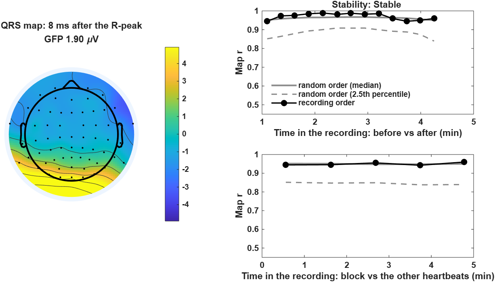
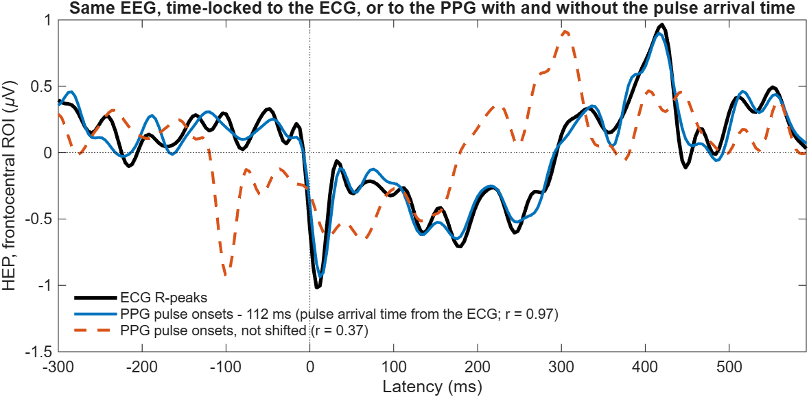

<!-- <p align="center"> -->
# BrainBeats
<!-- </p> -->

<p align="center" width="100%">
  
</p>


BrainBeats is an EEGLAB plugin to process and analyze EEG together with a cardiovascular signal (ECG or PPG) recorded at the same time, for brain-heart interplay research. It runs from its own entry in the EEGLAB menu bar or from the command line, and provides:

1. **Heartbeat-locked EEG** in three domains: time (heartbeat-evoked potentials, HEP), time-frequency (heartbeat-related spectral perturbations, HRSP) and phase (heartbeat-related phase consistency, HRPC), on scalp channels, independent components or both, with a surrogate heartbeat control (family-wise corrected), each heartbeat's baseline and ongoing power exported for group-level models, and the cardiac field artifact measured: its amplitude, its scalp map and whether that map changed during the recording (its removal optional, off by default)
2. **Heart rate variability (HRV) and EEG features** in the time, frequency and nonlinear domains

A brain-heart coherence analysis is also included for development (experimental, command line only, see the end).

The figures below come from the two sample datasets in `sample_data`, both 63-channel EEG, ECG and PPG at rest with eyes open, from [ds003838](https://nemar.org/dataexplorer/detail?dataset_id=ds003838): the heartbeat-locked EEG figures from `sub-047_rest.set` (5.3 min), which has a clearer heartbeat-evoked response, and the others from `dataset.set` (sub-032, 3.8 min, with added artifacts; the dataset of the tutorial). They are regenerated by `tests/make_readme_figures.m`.


## Installation

- MATLAB with the Signal Processing and the Statistics and Machine Learning toolboxes (Parallel Computing is optional, for 'parpool').
- [EEGLAB](https://github.com/sccn/eeglab) with the clean_rawdata, ICLabel and firfilt plugins (included by default). PICARD (fast ICA), REST (infinity reference) and GEDAI (artifact removal) are installed automatically when these options are selected.
- In EEGLAB: File > Manage extensions, search for BrainBeats, and install it. Or clone this repository into `eeglab/plugins`.
- Your data: one EEGLAB dataset with the EEG and heart channels recorded together.


## Quick start

Click **BrainBeats** in the EEGLAB menu bar. The window shows the current dataset (or loads one, or the sample dataset), and selects the analysis, the heart signal and channel(s), and, for HEP, whether the analysis is performed on the scalp channels, the independent components or both. **Next** opens the parameters of the analysis.

<p align="center" width="100%">
  
</p>

From the command line:

```matlab
eeglab; close
EEG = pop_loadset('filename','dataset.set','filepath', fullfile(fileparts(which('brainbeats_process')),'sample_data'));

% Window
[EEG, com] = pop_brainbeats(EEG);
```

Or without the window: HEP from the ECG channel, with EEG cleaning and 100 surrogate heartbeat trains. BrainBeats needs continuous data, so start from the loaded dataset, not from a HEP output, sampled at 1024 Hz at most (512 Hz is enough: higher rates only cost memory and time; the window offers to downsample). Outputs are saved next to the input file unless 'save' is false.

```matlab
EEG = pop_loadset('filename','dataset.set','filepath', fullfile(fileparts(which('brainbeats_process')),'sample_data'));
EEG = pop_select(EEG, 'nochannel', {'PPG'});    % only one type of heart signal
EEG = brainbeats_process(EEG, 'analysis','hep', 'heart_signal','ecg', ...
    'heart_channels',{'ECG'}, 'clean_eeg',true, 'hep_surrogates',100, 'save',false);
```

`brainbeats_tutorial.m` walks through every method with the sample data, and `help brainbeats_process` lists all options. Outputs are stored in `EEG.brainbeats` (parameters, heartbeats, signal quality, features, ROI or IC results, HRSP, surrogate results), and the command reproducing a GUI run is in the EEGLAB history (`eegh`).


## Overview

<p align="center" width="100%">
  
</p>

<sub>ASR: artifact subspace reconstruction. GEDAI: generalized eigenvalue de-artifacting instrument. HEP: heartbeat-evoked potential. HRSP: heartbeat-related spectral perturbation. HRPC: heartbeat-related phase consistency. HRV: heart rate variability. IAF: individual alpha frequency. ICA: independent component analysis. NN: normal-to-normal (cleaned) inter-beat intervals. PRSA: phase-rectified signal averaging. SDNN, RMSSD, pNN50: standard deviation, root mean square of successive differences, and share of successive differences > 50 ms of the NN intervals. SQI: signal quality index. VLF, LF, HF: very low, low and high frequency power.</sub>


## Heartbeat detection

All methods start from the heartbeats: R-peaks for ECG, pulse onsets ('valleys', default) or systolic peaks ('peaks') for PPG, or beat times detected with another tool ('heart_signal','rr' with 'beat_latencies' in s). Inverted signals are detected and flipped: ECG leads from the polarity of the QRS complexes, PPGs from the skewness of their slope (the systolic upstroke is the fast edge; most raw PPG outputs are light intensity, i.e. inverted, as all 14 of our test recordings). BrainBeats computes a signal quality index (SQI), flags ECG beats detected on the wrong wave (e.g. the T-wave), and corrects RR artifacts: a false beat is removed and its interval merged with the next one, an ectopic beat (a premature beat followed by a compensatory pause, classified with thresholds scaled to the recording's beat-to-beat variability; Lipponen & Tarvainen, 2019) is replaced by a beat in the middle of its two intervals, and missing beats are inserted in gaps. With several heart channels, the one with the fewest abnormal beats is used. PPG pulses are detected relative to the local pulse amplitude, so pulses are kept where the amplitude drops.

<p align="center" width="100%">
  
</p>
<p align="center"><em>ECG signal with the detected R-peaks, and the RR intervals before and after artifact correction (NN intervals).</em></p>


## EEG preprocessing

With 'clean_eeg' (on by default in the GUI):

- FIR filters: 0.5-30 Hz for HEP (the slow HEP components are kept), 1-40 Hz for features (the gamma band ends at 40 Hz); line noise notch; zero-phase or causal.
- HEP: ICA is fitted on a continuous copy of the data high-passed at 1 Hz (slow drifts degrade ICA and ICLabel), not low-passed (line noise and its harmonics notched, at 'linenoise' or at the 50 or 60 Hz peak detected in the data; 'ica_lowpass'), cleaned with a lax ASR that keeps the eye activity ('ica_asr', default 80 SD), and ICLabel classifies the components on it; the weights are applied to the 0.5-30 Hz data. On 6 recordings (`tests/ica_compare.m`), this copy gave as many or more dipolar ICs (residual variance < 15%) than a 30-Hz copy on each recording (in total 165 vs 144 with Picard, 156 vs 133 with Infomax), let ICLabel see muscle, and took half the ICA time of the former epoched copy; the HEP and the eye activity left were unchanged. Resampling a 30-Hz copy to 100 Hz was faster but gave fewer dipolar ICs (129 vs 133).
- Bad channels removed (clean_rawdata) and interpolated.
- Artifact removal ('clean_method'): bad epochs (HEP) or ASR (continuous data), then ICA and ICLabel ('asr_ica', default). Bad HEP epochs are outliers in amplitude or in high-frequency noise over the analysis window, the latter measured on the broadband copy the ICA is fitted on (the HEP data are low-passed at 30 Hz): with 15 added muscle-like bursts per recording, this caught 15 of 15 on 5 of 6 recordings, the former metrics 0-2 (`tests/compare_badepoch_metrics.m`); or GEDAI ('gedai'; Ros et al., 2025), which removes artifacts from the continuous data without ICA (installed from the EEGLAB extension manager if needed; noncommercial license).
- Reference ('ref'): average (default), infinity (REST), surface Laplacian ('csd', current source density with spherical splines; applied after the artifact removal, since ICLabel needs average-referenced data; channels must have 10-05 labels), or none.


## 1. Heartbeat-locked EEG: HEP, HRSP, HRPC

- EEG epochs from -300 to 600 ms around each heartbeat ('hep_window'), time-locked to the heartbeats kept after RR correction. Heartbeats followed by the next one before the end of the epoch + 50 ms are rejected, so no epoch contains the next QRS, as are outlier inter-beat intervals. 'hep_window','adaptive' sets the epoch end from the subject's heart rate (within-subject analyses only).
- No baseline correction: the pre-R-peak window holds activity of the previous cardiac cycle, and the recent methods review of Steinfath et al. (2026) recommends reporting HEPs without baseline correction and testing the baseline window. For a regression-based correction (Alday, 2019), each heartbeat's baseline voltage is exported (below) for the group-level model: within one recording, a regressor centered on its mean cannot change the average HEP ('hep_baseline' was removed in v1.7). BASELINE_REGRESSION applies it to epochs that pool conditions. Without 'clean_eeg', the EEG must already be high-pass filtered: BrainBeats stops on unfiltered data, whose channel offsets (hundreds of times their variability within 1 s in raw recordings) would otherwise be the HEP and its scalp maps.
- Values of each heartbeat before its QRS, for group-level covariates or single-trial models (EEG.brainbeats.prestim; with 'save', the ROI values in `<file>_HEP_beats.csv`): the baseline voltage ('hep_baseline_win'; the regressor of Alday's correction) and the induced theta, alpha and beta power from the epoch start to -50 ms, with each heartbeat's time and inter-beat interval. They are not used to correct the HEP: within one recording, a regressor centered on its mean cannot change the average HEP. They matter when conditions or groups differ in ongoing power.
- HRSP and HRPC (pairwise phase consistency across heartbeats) from 4 to 30 Hz, with 5-cycle Morlet wavelets applied to the continuous data. HRSP is expressed relative to the whole cardiac cycle. HRPC is the pairwise phase consistency across heartbeats (Vinck et al., 2010), unbiased by the number of heartbeats. The HRSP plotted is that of the induced power: the HEP, cardiac field artifact included, is subtracted from each heartbeat before the power is taken (Cohen & Donner, 2013), over the whole wavelet support (no edge effect); 'hep_tf_power','total' plots all the power, and both are stored. The QRS complex's broadband field is in every epoch: with all the power, latencies away from it show a power decrease relative to the cycle that the surrogate control finds significant (synthetic QRS 5 times the noise SD, amplitude varying 15% across heartbeats: -1.9 dB, every point away from the QRS FDR-significant); with the induced power, -0.08 dB and none (`tests/test_compute_hep_tf.m`). The subtraction removes the heartbeat-locked part only as far as it repeats identically from beat to beat.
- Where ('hep_level'): on all channels ('channels', default; plots of the average of a channel ROI, 'hep_roi', default frontocentral: F1-F4, Fz, FC1-FC4, FCz, C1-C4, Cz), on the independent components ('ics'), or both ('both'). The three measures and the surrogate control are computed the same way in both cases.
- Independent components: the HEP, HRSP, HRPC and surrogate control of every IC left after the cleaning (of the cleaning ICA, or of an ICA run for this), exported with their scalp maps and ICLabel classes; the IC numbers are those of the decomposition, and the ICs removed by the cleaning are listed. BrainBeats does not select ICs: whether a heartbeat-locked brain response can be separated from the cardiac field artifact is not established, and on the sample data the most heartbeat-locked ICs also followed the ECG's QRS or T-wave.
- Surrogate heartbeat control ('hep_surrogates', e.g. 100): one surrogate beat is drawn at a random position in each inter-beat interval, so the surrogate beats fall at random cardiac phases, and their windows avoid the epochs rejected by the cleaning and the data before the first and after the last epoch, which no cleaning step checks (on the tutorial dataset, whose first seconds hold large artifacts, the surrogate band was 4.6 times narrower with these exclusions). The HEP, HRSP and HRPC at each latency are compared with the surrogates. For the HEP (at least 1000 surrogates), the points shown as different ('hep_surr_stat') are family-wise corrected over all latencies (and channels or ICs) with the max statistic ('tmax', default), or with threshold-free cluster enhancement along time ('tfce'; Smith & Nichols, 2009), which favors sustained effects over isolated peaks, or per point with FDR ('fdr'); the max statistic and FDR are always stored, TFCE only when chosen. On simulated noise (`tests/sim_hep_fwer.m`), all three kept the chance of any false positive at or below ~5%; with a response at 400 ms, FDR flagged other latencies in 14% of the runs (max statistic 4%, TFCE 7%), and TFCE detected the response most often (51% vs 43-45% with one channel, 20% vs 13% with 16 channels), but it took 28% of the computing time (16 channels, 27 frequencies, 100 surrogates), hence the max statistic by default. The surrogates sample all cardiac phases, so each latency is compared with the average over the cardiac cycle: a large heartbeat-locked deflection (the QRS, a strong HEP) moves the rest of the cycle the other way, and latencies without a response of their own then differ too (response of 0.5 noise SD: TFCE flagged other latencies in 35-60% of the runs; 1 SD: in all). Away from a large deflection, a significant point means "differs from the cycle average", not "heartbeat-locked activity at this latency". A pre-R-peak reference would avoid this only if its window held no heartbeat-locked activity: in simulations with an ECG-shaped cardiac field it did (other latencies flagged in 2-9% of the runs vs 15-47% against the cycle average; `tests/sim_surrogate_reference.m`), but on real recordings the P wave falls 100-170 ms before the R-peak and, at faster heart rates, the previous heartbeat's late activity reaches -300 ms, and the latencies found changed with the window (`tests/check_surrogate_reference.m`). HRSP and HRPC get the same statistics (family-wise over channels, frequencies and latencies; the contours of the plots use 'hep_surr_stat'). This is a check of heartbeat locking: the cardiac field artifact is heartbeat-locked too, so it does not show a neural origin, and it does not compare conditions. (Shifting the whole train instead, as Park et al., 2018, keeps the surrogates heartbeat-locked: that tests contrasts between conditions; 'hep_surrogate_mode' was removed in v1.7.)
- PPG: the pulse reaches the sensor after the heartbeat (pulse arrival time), so the PPG beats are shifted back by it ('ppg_transit','auto'), measured from an ECG channel of the file. Without an ECG, give the delay in ms (e.g. measured with an ECG on the same device and sensor site), or 'eeg' to estimate it from the cardiac field artifact of the EEG, which precedes each pulse by that delay: check its figure. On 6 subjects of ds003838 (pulse onsets at the finger, 92-112 ms after the R-peak), the ECG-based correction recovered the ECG-locked HEP (r = .68-.92; .16-.39 without it), the EEG estimate was right on 3, wrong on 1 (by 300 ms) and not clear enough on 2, and a fixed 250 ms did not fit any: there is no silent estimate without an ECG.

The cardiac field artifact is not removed by default, and can remain after any removal method (see Heart artifact below), around the QRS and over the T wave (~200-400 ms), the usual HEP window. The heart-locked EEG amplitude before and after the cleaning is printed and stored in EEG.brainbeats.preprocessings for both windows: -50 to 100 ms (cfa_before, cfa_after) and 200 to 500 ms (cfa_late_before, cfa_late_after), the latter including any neural HEP. Check them before interpreting HEP effects.

QRS map ('hep_cfa', on by default; EEG.brainbeats.cfa, and with 'save' `<file>_HEP_CFA.png` and `_HEP_CFA.txt`): the scalp map of the cardiac field artifact at the QRS, with notes on how to use it. Its shape follows the orientation of the heart's electrical axis relative to the electrodes, so it changes with posture (lying, sitting, standing), with the orientation of the head relative to the torso (turning or nodding; Dirlich et al., 1997), with the electrode positions and the reference, and between people. Compare conditions on it: different maps mean different cardiac field artifact left in the data, which alone can produce HEP differences. Record all conditions in the same posture with the head supported the same way; posture also changes the HEP itself (larger lying down than upright; Plantard et al., 2025). BrainBeats also tests whether the map changed during the recording (map of the heartbeats before vs after each time point, and of each block vs the rest, against the same with the heartbeats in random order) and warns if it did. The test only sees large lasting changes: simulating a head turn for half of the recording by rotating the electrodes in a fixed cardiac field (`tests/sim_cfa_drift.m`, 12 resting recordings of 120-370 heartbeats, raw and cleaned), it never fired on the unchanged recordings and detected a 30° turn in 3-4 of 12, a 20° turn in 1-2, a 10° turn in 0-1. A shifted time-locking changes the map too (a PPG pulse arrival time drifting by ~20 ms or more, R-peaks detected on another wave). A stable result does not exclude movements.

<p align="center" width="100%">
  
</p>
<p align="center"><em>HEP from the ECG (cleaned EEG): all electrodes with scalp maps at the R-peak (cardiac field artifact) and at the largest deflections of the ROI HEP at 150-350 ms and after 350 ms (top), each with its spatial correlation with the cardiac field artifact at the QRS (r<sub>CFA</sub>; the map at the largest global field power from -30 to 60 ms; here the 420-ms map resembles the inverted QRS map, r = -0.62, which this map alone cannot attribute to the heart or the brain), and single heartbeats of the frontocentral ROI (bottom).</em></p>

<p align="center" width="100%">
  
</p>
<p align="center"><em>Frontocentral ROI: HEP against 1000 surrogate heartbeat trains (gray: 95% of the surrogates; red: max-statistic p < .05, family-wise), HRSP of the induced power (HEP subtracted from each heartbeat; dB relative to the cardiac cycle) and HRPC, with the contours of max-statistic p < .05 (family-wise). Dashed white lines: ±2 SD of the wavelets around the R-peak, where the time-frequency values include the QRS. Dotted white lines: the same for the nearest previous and next heartbeats. Here the HEP differs from the surrogates (the cardiac-cycle average) at the QRS, at 172-184 ms (and one point at 244 ms), and at 396-428 ms (+1 µV, after the end of the T wave at ~300 ms; largest at Fz, F1, FC2 and Cz, not at the frontal pole).</em></p>

<p align="center" width="100%">
  
</p>
<p align="center"><em>QRS map ('hep_cfa'): the scalp map of the cardiac field artifact at its largest global field power (8 ms after the R-peak), and its stability over the recording: correlation of the map of the heartbeats before vs after each time point (top) and of each fifth of the recording vs the other heartbeats (bottom), against the same with the heartbeats in random order (gray: median and 2.5th percentile). Here stable.</em></p>

<p align="center" width="100%">
  
</p>
<p align="center"><em>Frontocentral HEP of the same EEG time-locked to the ECG R-peaks (black), to the PPG pulse onsets shifted back by the pulse arrival time measured from the ECG (blue), and to the PPG pulse onsets themselves (orange): without the shift, the cardiac field artifact and the HEP come one pulse arrival time too early.</em></p>

<p align="center" width="100%">
  
</p>
<p align="center"><em>Independent components ('hep_level','ics'), ECG: scalp map, ICLabel class and HEP of each IC left after the cleaning (the first 24; IC 2 was removed by the cleaning), against 1000 surrogate heartbeat trains (gray: 95% of the surrogates; red: max-statistic p < .05, family-wise over all ICs and latencies). Some ICs follow the QRS complex and the T wave (e.g. IC 15) or the QRS only (ICs 6, 10 and 16, classified brain): cardiac field artifact that ICLabel did not classify as heart.</em></p>

<p align="center" width="100%">
  
</p>
<p align="center"><em>The same from the PPG (beats shifted back by the pulse arrival time). The ICA is fitted on the same continuous copy of the data, so the ICs are those of the ECG run.</em></p>


### Heart artifact

The electrical field of the heart reaches the scalp (cardiac field artifact) and is time-locked to the heartbeat, like the HEP. In the HEP analysis, 'heart_removal' sets whether the EEG cleaning removes it. **The default is 'none', and we recommend keeping it**: on our test data, every method either found nothing to remove or also removed heartbeat-locked brain activity (table below). The methods are there to compare and to check results, not as a correction:

- 'ica': the independent components (ICs) that ICLabel classifies as heart ('conf_thresh', default 0.75) are removed with the other artifact ICs.
- 'ica_caracas': the ICs that CARACAS classifies as cardiac (Champetier et al., 2025: R waves detected in each IC's time course; no ECG needed). Needs the SASICA plugin (`git clone --recurse-submodules https://github.com/dnacombo/SASICA` into `eeglab/plugins`). It runs on the continuous data, without the stretches of large artifacts.
- 'ica_ecg' (ECG): the ICs whose time course correlates with the ECG (|r| ≥ 'ecg_corr', default 0.6, as in SASICA). The correlations are stored in EEG.brainbeats.preprocessings.heart_ics.
- 'ecg_regression' (ECG, no ICA): the ECG, filtered like the EEG and shifted by -20 to +20 ms, is regressed out of each EEG channel. The fit uses the samples without large EEG artifacts.
- 'ssp' (ECG): the first 'ssp_n' (default 2) scalp topographies of the heartbeat-locked average EEG are projected out of the data (signal-space projection, as MNE's compute_proj_ecg). The projection removes these topographies at all times, brain activity included.

The heart-locked EEG amplitude is printed and stored in EEG.brainbeats.preprocessings before and after the cleaning, around the QRS (-50 to 100 ms: cfa_before, cfa_after) and from 200 to 500 ms (cfa_late_before, cfa_late_after; this window also holds any neural HEP). Check them before interpreting HEP effects.

On 6 subjects of ds003838 (resting state, 63 channels, ~3 min each; `tests/compare_heart_removal.m`, which also adds a synthetic 1-µV response 300 ms after each R-peak on the frontocentral channels and measures how much of it is left):

| | Heart-locked amplitude removed (-50 to 100 ms) | Synthetic response kept (vs no removal) |
|---|---|---|
| 'ica' | 0% on all 6 (ICLabel found no heart IC) | 100% |
| 'ica_caracas' | 0% on all 6 (no IC classified as cardiac; on the sample data, the IC most correlated with the ECG failed only the skewness criterion) | 100% |
| 'ica_ecg' | 0% on all 6 (no IC reached \|r\| = 0.6; 0.55 at most on the sample data) | 100% |
| 'ecg_regression' | 29% on average (3-70%; ~70% where the artifact was largest, ~2 µV) | 80% on average (54-100%) |
| 'ssp' | 52% on average (27-73%) | 57% on average (39-76%) |
| ICA with the ECG channel (former 'rm_heart', removed in v1.6) | 19% (0-47%) | 7% on average (5 of 6 near 0%) |

The methods that remove part of the artifact also remove heartbeat-locked brain activity, and the methods that select ICs found none to remove in these recordings (short, low artifact amplitude). The synthetic response is idealized (perfectly heartbeat-locked, fixed topography), so real losses may be smaller, but nothing tells the methods apart from a real HEP. In patients with an isoelectric EEG (no brain activity, so any heartbeat-locked signal is artifact), the artifact varied widely between patients and was not predicted by their ECG, possibly because it includes pulse-related movement; compared with controls, removing heart ICs weakened the HEP effect, and the surface Laplacian removed an effect that depended on the reference (Kandasamy et al., 2026, preprint).

The cardiac field artifact is not a constant either. Breathing rotates the electrical axis of the heart and changes the impedance of the thorax, so the ECG, and the artifact, change over the respiratory cycle (the basis of ECG-derived respiration; Moody et al., 1985). Heart rate moves the T wave (the QT interval shortens as heart rate rises), and stroke volume and body position change the artifact too: the heartbeat-evoked MEG response co-varied with stroke volume from beat to beat only when the cardiac artifact was not corrected (Buot et al., 2021). So conditions that differ in breathing, heart rate, stroke volume or posture can produce HEP differences without any difference in brain activity, whether the artifact is removed or not. Instead of relying on a removal method:

- compare the ECG between conditions: its heartbeat-locked average, heart rate and, if recorded, breathing;
- check the heart-locked amplitudes reported above, and whether an effect overlaps the QRS or the T wave of the ECG;
- use the surrogate heartbeat control ('hep_surrogates') for heartbeat locking, and the surface Laplacian ('ref','csd'), which attenuates the broad cardiac field relative to local activity;
- for condition contrasts, use a surrogate-heartbeat correction (Steinfath et al., 2026) or, in task data, a pseudotrial correction (doi:10.1162/IMAG.a.30).


## 2. EEG and HRV features

From the continuous data:

- HRV time domain: SDNN, RMSSD, pNN50
- HRV frequency domain: ULF, VLF, LF and HF power (ms²), LF/HF ratio, relative power ('hrv_norm'); Lomb-Scargle periodogram by default, 'welch' or 'fft' on the NN series resampled at 7 Hz, or 'LombScargle_norm' (unitless, divided by the variance of each window: its values grow with the heart rate)
- HRV nonlinear domain: Poincaré (SD1, SD2, SD1/SD2), fuzzy entropy, fractal dimension, PRSA acceleration and deceleration capacities (Bauer et al., 2006; anchors whose interval changes by more than 20% are left out, 'prsa_thresh'. Bauer et al. used 5% on 24-h recordings, which left out 18-61% of the anchors and halved the capacities on our 3-min resting recordings, so the values are not comparable with their risk cut-offs)
- EEG time domain: RMS, variance, skewness, kurtosis, IQR
- EEG frequency domain: band power (delta 1-4, theta 4-8, alpha 8-13, beta 13-30, gamma 30-40 Hz, each from its lower edge up to its upper edge; optionally individualized from the alpha peak), individual alpha frequency (IAF, alpha center of gravity) and peak alpha frequency, alpha asymmetry (ln right - ln left alpha power, e.g. F4 - F3: positive values mean relatively more left-hemisphere activity; each left electrode paired with its mirror position), absolute and relative power, band ratios, median and 90% spectral edge frequencies
- EEG nonlinear domain: fuzzy entropy, fractal dimension

<p align="center" width="100%">
  
</p>
<p align="center"><em>Power spectral density of the HRV (ms²/Hz) and of the EEG (dB, 20% trimmed mean across channels), with the frequency bands used and the individual alpha frequency (IAF).</em></p>

<p align="center" width="100%">
  
</p>
<p align="center"><em>EEG features on the scalp: band power, IAF, fuzzy entropy, fractal dimension and alpha asymmetry.</em></p>


## 3. Brain-heart coherence (experimental)

Coherence, partial coherence, directed coherence and partial directed coherence between each EEG channel and the NN series, from a multivariate autoregressive model ('analysis','coherence', command line only). **Do not interpret these values.** The NN series is interpolated at the EEG sampling rate and high-passed at 0.5 Hz, so it holds almost no heart rate variability in the 0-40 Hz bands analyzed, and the model is not fitted at the time scales of heart rate variability. The analysis is kept for development and is not offered in the BrainBeats window.


## Tutorials

- `brainbeats_tutorial.m` (command line, all methods, sample data)
- JoVE article (v1.4): https://www.jove.com/t/65829/brainbeats-as-an-open-source-eeglab-plugin-to-jointly-analyze-eeg
- JoVE video: https://www.jove.com/v/65829/author-spotlight-advancing-study-brain-heart-interplay-with

The JoVE tutorial describes v1.4: the menu, some defaults and results have changed since (see the version history).


## Version history

v1.7 (in development) - HEP: decomposition, statistics, time-frequency and new outputs. Results of HEP analyses change:
- ICA for HEP is fitted on a continuous copy of the data high-passed at 1 Hz, not low-passed, with a lax ASR (80 SD; 'ica_asr', 'ica_lowpass', 'ica_epochs', 'ica_srate'), and ICLabel classifies the components on it (was an epoched 1-30 Hz copy). The copy's line noise is notched at the 'linenoise' frequency, or at the one detected in the data (50 or 60 Hz; 63 of 66 recordings of ds003838 and the sample data, all 50 Hz, the other 3 had no clear peak), and with 'heart_removal','ssp' the copy gets the same projection as the data.
- Surrogate control of the HEP, HRSP and HRPC: family-wise statistics over latencies and channels or ICs (and frequencies), the max statistic by default ('hep_surr_stat': 'tmax', 'tfce' or 'fdr'; was per-point FDR), with at least 1000 surrogate HEPs.
- The HRSP plotted is that of the induced power: the HEP, cardiac field artifact included, is subtracted from each heartbeat (Cohen & Donner, 2013; 'hep_tf_power'); the total-power HRSP, still stored, showed a power decrease away from the QRS caused by the QRS itself.
- New QRS map of the cardiac field artifact and test of its change during the recording ('hep_cfa', on by default; figure, and with 'save' a PNG and notes), and each heartbeat's baseline voltage and pre-R-peak band power exported for group-level models (EEG.brainbeats.prestim; with 'save' a CSV). The HEP figure's scalp maps show their correlation with the QRS map (r_CFA).
- Removed: the recording-level regression-based baseline correction ('hep_baseline'; it could not change the average HEP and now only warns). BASELINE_REGRESSION remains for epochs that pool conditions. Also removed: 'hep_surrogate_mode','rigid' (a train shifted as a whole is still heartbeat-locked: it tests condition contrasts, not one condition).
- HEP without 'clean_eeg' stops on unfiltered EEG (no baseline correction: the channel offsets would be the HEP). Data above 1024 Hz must be downsampled (the window asks; 512 Hz recommended).
- RR cleaning: ectopic beats are found with the adaptive beat classification of Lipponen & Tarvainen (2019) ('ectopic_rule','adaptive', default; 'ratio' is the fixed 20% rule of v1.6). On 40 ds003838 and sample recordings with injected premature beats, it detected 92-96% of those at 0.80 x the interval (fixed rule 13-15%), 96-97% at 0.75 x (60-65%), and the RMSSD error after correction fell from 13-23 to 1-7 ms; on the recordings as they are (12,800 beats) it replaced 5 beats the fixed rule kept: 2 false detections, 1 sinus beat and 2 unclear (`tests/compare_ectopic_rules.m`).
- HRV: LF and HF come from the same 120-s windows (were 125 s for LF and 34 s for HF), spread over the whole recording with at least the 'hrv_overlap' overlap (a fixed step left out 3-35% of 3-5 min recordings). On 6 recordings (Lomb-Scargle), HF is 2-24% lower (the 34-s windows let LF power into HF), LF -15 to +13%, and the normalized LF/HF now matches the ms² one. Recordings of 60-120 s give HF only; band powers are NaN below 60 s (`tests/compare_hrv_windows.m`).
- Bad HEP epochs: detected over the analysis window, with the high-frequency noise of the broadband ICA copy (the former metric, on the 30-Hz low-passed data, saw no muscle activity); the surrogate windows avoid the rejected epochs and the data outside the epoched range (the tutorial dataset's surrogate band was 4.6 times too wide).
- Thresholds relative to the data instead of absolute (they failed in other units, e.g. volts): ICA rank, ECG flatline check, PPG clipping check. With fewer than 30 channels, a warning explains that the data keep their recording reference.
- HEP figure: the colors of the single-heartbeat image are scaled to the bulk of the heartbeats (a few artifact heartbeats made it look blank). The surrogate time-frequency statistics run faster (same results).
- Command line: switches accept 'on'/'off' ('clean_eeg','off' turned the cleaning on, 'save','off' saved); the EEGLAB history now includes the heartbeat-detection, SSP, ECG-correlation and channel-cleaning options; the line-noise notch works at any sampling rate (it failed from 910 Hz).

v1.6 (11/2026) - Many fixes and a few additions (see below). Results of some features change:
- BrainBeats now has its own entry in the EEGLAB menu bar (was Tools > BrainBeats). It opens a main window (dataset, which can also be loaded there, analysis, heart signal and channels, IC measures for HEP), then the parameters of the analysis. Heart artifact removal is an option of the HEP analysis there ('heart_removal', off by default: ICA with ICLabel, CARACAS or the ECG correlation, ECG regression, or SSP, see Heart artifact; the separate 'rm_heart' analysis was removed, see below), unused options were removed (e.g. the PPG 'learning period', which no code used), and the command line of a GUI run in the EEGLAB history now includes every option.
- Heartbeats: improved R-peak detection and correction (get_RR, clean_rr: a removed false beat now merges its interval with the next one; missing beats are inserted in gaps), per-electrode outputs with several heart channels, new R-peak QA report (rpeak_qa: flags beats detected on the wrong wave, e.g. T-wave), ECG artifact detector (detect_ecg_artifacts), PPG 'ppg_detect_mode' ('valleys' or 'peaks'). Ectopic beats (premature beat then compensatory pause) are now removed and replaced by a beat in the middle of the merged interval: they passed the RR cleaning before (6 injected premature beats raised RMSSD from 36.5 to 83.2 ms; 36.5 ms after cleaning). Inverted PPGs (light intensity, the raw output of most devices, and of all our test recordings) are detected and flipped, so 'valleys' are the pulse onsets: before, they marked the systolic peaks of such recordings (~400 ms after the R-peak instead of ~100 ms). PPG pulses are detected with a prominence relative to the local pulse amplitude (a global height threshold missed the low-amplitude pulses: 301 instead of 306 beats on the sample data).
- New regression-based baseline correction of HEP epochs ('hep_baseline','regression'; Alday, 2019): the baseline is used as a trial-level regressor instead of being subtracted, and the corrected epochs are stored in the output dataset, ready for further analyses (BASELINE_REGRESSION can also be called directly with condition labels).
- New 'rr' heart signal: provide beat times detected elsewhere ('beat_latencies', in s) for HEP or HRV features.
- EEG preprocessing: new GEDAI artifact removal ('clean_method','gedai'). The infinity reference ('ref','infinity') and the surface Laplacian ('ref','csd') work: both silently fell back to the average reference (REST could not find its files when EEGLAB had not added its subfolders; CSD was missing). The surface Laplacian is applied after the artifact removal. For HEP, the high-pass is now 0.5 Hz by default (was 1 Hz), and ICA is fitted on a 1-Hz high-passed copy of the data.
- HEP: epochs are now -300 to 600 ms by default ('hep_window'; was -300 to 700 ms), and heartbeats followed by the next one before the epoch end + 50 ms are rejected, so no epoch contains the next QRS (with -300 to 700 ms and a 550 ms limit, 28% of the sample-data epochs did). 'hep_window','adaptive' sets the epoch end from the subject's heart rate, for within-subject analyses. The inter-beat-interval rejection now actually removes trials (all events were epoched before), epochs are time-locked to R-peaks only (not to other events in the file), and to the beats kept after RR cleaning.
- HRSP (heartbeat-related spectral perturbations; was 'HEO') and new HRPC (heartbeat-related phase consistency: the pairwise phase consistency across heartbeats, unbiased by their number): zero-phase 5-cycle Morlet wavelets, 4-30 Hz, applied to the continuous data and indexed at the same heartbeats as the HEP epochs; HRSP is expressed relative to the whole cardiac cycle (the pre-R-peak baseline overlapped the QRS once smeared by the wavelets). They are computed for all channels (EEG.brainbeats.hrsp), plotted for the average of a channel ROI (default frontocentral, 'hep_roi'), and computed for all independent components with 'hep_level' 'ics' or 'both'.
- Surrogate heartbeat control ('hep_surrogates', e.g. 100): surrogate heartbeats at random cardiac phases (or the whole train rigidly shifted by up to +/-500 ms, 'hep_surrogate_mode','rigid'; Park et al., 2018), and the HEP, HRSP and HRPC at each latency are compared with the surrogates (z-scores, FDR-corrected p-values, with an exponential tail for HRPC; EEG.brainbeats.surrogate). With EEG cleaning, the continuous data get exactly the same cleaning as the epochs.
- HEP baseline: none by default, as recommended by Steinfath et al. (2026); the regression baseline window is now [-150 -50] ms (was [-300 -100]). With 'keep_heart', the heart channel is added after the EEG cleaning and keeps its units (it went through the ICA and was rescaled).
- PPG: HEPs are time-locked to the heartbeats rather than to the pulses ('ppg_transit', 'auto' by default): the pulse arrival time is measured from an ECG channel of the file (ESTIMATE_PAT); without an ECG it must be given (a delay in ms, or 'eeg' for the estimate from the cardiac field artifact of the EEG, ESTIMATE_PAT_EEG). On the sample data, the arrival time to the pulse onsets was 112 ms with the ECG and 104 ms from the EEG, and the PPG-based HEP correlated with the ECG-based HEP at r = 0.92 after correction (r = 0.39 before).
- EEG band power: theta, alpha, beta and gamma used wrong frequency edges (bin indices instead of Hz); fixed. Bands now join (delta 1-4, theta 4-8 Hz, each band from its lower edge up to its upper edge): the bins between 3 and 4 Hz and between 7 and 8 Hz belonged to no band, and the relative powers did not sum to 1. Alpha asymmetry is now ln(right) - ln(left), the usual convention (it was left - right: the sign of earlier values is reversed). The time-domain 'mode' (meaningless on continuous signals) was removed, and the qEEG peak alpha frequency is named 'paf' (was 'iaf', which is the center of gravity in frequency.IAF). The 'individualized' band option works again: alpha is bounded by the individual alpha peak (median across channels), with the theta and beta edges moved accordingly (the band limits used are in frequency.bands). IAF threshold (restingIAF) restored to log10. Alpha asymmetry pairs each left electrode with its mirror position (it could pair C3 with T8), and its 'asy_norm' option now divides alpha by each channel's total power. Entropy features are computed at the actual resampled rate.
- HRV: pNN50 is now in % (was a fraction rounded to one decimal), PRSA acceleration/deceleration capacities follow Bauer et al. (2006) (were the mean NN at the anchors), LF/HF is no longer divided by total power with 'hrv_norm'. Band powers: the default is now the Lomb-Scargle periodogram in ms² ('LombScargle'; was the normalized periodogram, 'LombScargle_norm', unitless, whose values were multiplied by 1e6 and labelled ms² in v1.5). The normalized periodogram divides each window by its variance, and LF and HF come from windows of different lengths, so its band values are not comparable between bands, and they grow with the heart rate (same modulation in ms: LF +41% at 90 vs 60 bpm, ms² -3%). The periodogram is computed on a finer frequency grid (it had ~2 points per HF peak, which made the band integral and the plotted spectrum coarse). the mean NN is removed before Welch/FFT (it inflated LF and HF), the 'fft' method works (it crashed), and recordings shorter than 34 s return NaN band powers instead of crashing.
- ECG/PPG signal quality: windows where the two detectors agree on no beat now count as bad (were ignored); the PPG SQI now covers the whole recording (only the last 30 s were kept), is computed on the filtered PPG, and the bad portion is the beats of unacceptable quality (Li & Clifford, 2012) rather than an SQI below .9, which also flagged normal long beats: 1% instead of 33% on the clean sample PPG.
- Brain-heart coherence: the MVAR model is now fitted to the data before computing the coherence measures (the data were passed as model coefficients). It stays experimental and command-line only: the heart signal holds almost no heart rate variability in the bands analyzed.
- EEG features: with 'clean_eeg' on the command line, the default low-pass is now 40 Hz, as in the GUI (it was 30 Hz, under the 30-40 Hz gamma band), and the ASR cutoff 30 SD, as in the GUI (it was 50). 'eeg_norm',2 now gives the relative power, and band values are no longer rounded to 3 decimals.
- License: the plugin header now says GPL version 3 or later, as the LICENSE file (it said version 2 or later). GEDAI (noncommercial license) is no longer installed without asking in the MATLAB desktop.
- Command line: failed input checks and unknown inputs now raise errors, inputs of earlier versions and cleaning options without 'clean_eeg' give a warning, the BrainBeats version is stored with the parameters and the features file holds them too.
- Heart artifact: the heart-locked EEG amplitude is now also reported from 200 to 500 ms, and for every removal method. As in v1.5, the heart artifact is not removed by default in the HEP cleaning: on 6 test subjects, every method found nothing to remove or also removed a synthetic heartbeat-locked brain response (see Heart artifact). New removal options to compare: CARACAS (SASICA plugin), ICs correlated with the ECG, ECG regression, and SSP.
- The 'rm_heart' analysis was removed: ICA with the ECG channel (and ICLabel) removed most of a synthetic heartbeat-locked brain response on 5 of 6 test subjects (ds003838), so it can remove the HEP itself. Heart artifact removal is part of the HEP cleaning ('heart_removal').
- Command line: 'icamethod' (or 'ica_method'), 'conf_thresh', and get_RR options are now parsed; 'parpool','off' and 'eeg_features'/'hrv_features','off' work; parallel pool uses the 'Processes' profile and no longer changes your saved parallel settings. Runs under 'matlab -batch' no longer block on dialogs or the progress bar.
- GUI: new HEP options (epoch window, baseline correction, ROI, HRSP/HRPC, surrogate control, and the PPG pulse arrival time); reference and filter-type choices were mapped to the wrong options in some modes (fixed).
- Figures: toolbars hidden and figures drawn right away in recent MATLAB versions (they stayed blank during ICA); the bad-epochs plot shows the rejected epochs with their own events and automatic scaling. New figure of the independent components at the IC level (scalp map, ICLabel class, and HEP against the surrogates of each IC). The HEP figure shows scalp maps at the R-peak and at the largest early (150-350 ms) and late (after 350 ms) deflections of the ROI HEP.
- Second sample dataset, `sample_data/sub-047_rest.set` (another participant of ds003838, 5.3 min, without added artifacts), with a clearer heartbeat-evoked response: the README HEP figures are made from it. `dataset.set`, used by the tutorial, is unchanged.

v1.5 (5/2/2024) - METHOD 4 (brain-heart coherence) added

v1.4 (4/1/2024) - publication JoVE (methods 1, 2, 3)

## When using BrainBeats, please cite:

Cannard, C., Wahbeh, H., & Delorme, A. (2024). BrainBeats as an Open-Source EEGLAB Plugin to Jointly Analyze EEG and Cardiovascular Signals. Journal of visualized experiments: JoVE, (206).


## BrainBeats was used or cited in:

Abdollahpour, N., & Artan, N. S. (2025). Significant interactions in infant operculum regions when exposed to a bilingual environment: a resting-state fNIRS study. Neurophotonics, 12(4), 045012-045012.

Abdullah, J.et al. (2025). Mathematical Decoding of the Correlation Between Different Organs' Activities: A Review. Fractals, volume 33, issue: 09.

Liu, P., Gao, Y., Ballegaard, M., & Puthusserypady, S. (2025, July). A Novel Framework for Real-Time ECG and Blood Pressure Signal Analysis: Enhancing Accuracy and Interaction through Dynamic Quality Evaluation. In Annual International Conference of the IEEE Engineering in Medicine and Biology Society. IEEE Engineering in Medicine and Biology Society. Annual International Conference (Vol. 2025, pp. 1-7).

Carbone, F., Silva, M., Leemann, B., Hund-Georgiadis, M., & Hediger, K. (2025). Registered Report Stage I: Neurological and physiological effects of animal-assisted treatments for patients in a minimally conscious state: a randomized, controlled cross-over study. Neuroscience.

Balasubramanian, K. et al. (2025). Complexity Measures in Biomedical Signal Analysis: A Clinically-Grounded Survey Across EEG, ECG, Intracranial Pressure, and Photoplethysmogram Modalities. IEEE Access.

Remiszewski, M. (2025). Long-term Aerobic Exercise Enhances Interoception and Reduces Symptoms of Depression and Anxiety in Physically Inactive Young Adults: A Randomized Controlled Trial. Psychology of Sport and Exercise, 102939.

Chowdhury, et al. (2025). Neural Signals, Machine Learning, and the Future of Inner Speech Recognition. Frontiers in Human Neuroscience, 19, 1637174.

Naaz, R., & Ahmad, S. (2025). ECG Data Mining Approach for Detection of Arrhythmia Using Machine Learning. In 2025 3rd International Conference on Device Intelligence, Computing and Communication Technologies (DICCT) (pp. 52-57). IEEE.

Cheng, X., Maess, B., & Schirmer, A. (2025). A Pleasure That Lasts: Convergent neural processes underpin comfort with prolonged gentle stroking. Cortex.

Georgaras, E., & Vourvopoulos, A. (2025). Physiological assessment of brain, cardiovascular, and respiratory changes in multimodal motor imagery brain-computer interface training. Research in Biomedical Engineering and Technology, 12(1), 2471680.

Park, S., Ha, J., & Kim, L. (2025). Improving single-trial detection of error-related potentials by considering the effect of heartbeat-evoked potentials in a motor imagery-based brain-computer interface. Computers in Biology and Medicine, 195, 110563.

Perez, T. M., Drake, E., & Sullivan, S. (2024). Assessing central nervous system and peripheral nervous system functioning in resting and non-resting conditions in a healthy adult population: A feasibility study. Chiropractic Journal of Australia (Online), 51(1), 1-32.

Akuthota, S., Rajkumar, K., & Janapati, R. (2024). Intelligent EEG Artifact Removal in Motor ImageryBCI: Synergizing FCIF, FCFBCSP, and Modified DNN with SNR, PSD, and Spectral Coherence Evaluation. In 2024 International Conference on Circuit, Systems and Communication (ICCSC) IEEE.

Ingolfsson et al. (2024). Brainfusenet: Enhancing wearable seizure detection through eeg-ppg-accelerometer sensor fusion and efficient edge deployment. IEEE Transactions on Biomedical Circuits and Systems.

Fields, C., et al. (2024). Search for entanglement between spatially separated Living systems: Experiment design, results, and lessons learned. Biophysica, 4(2), 168-181.

Cannard, C., Delorme, A., & Wahbeh, H. (2024). Identifying HRV and EEG correlates of well-being using ultra-short, portable, and low-cost measurements. bioRxiv, 2024-02.

Arao, H., Suwazono, S., Kimura, A., Asano, H., & Suzuki, H. (2023). Measuring auditory event‐related potentials at the external ear canal: A demonstrative study using a new electrode and error‐feedback paradigm. European Journal of Neuroscience, 58(11), 4310-4327.

Goodwin, A. J., et al. (2023). The truth Hertz—synchronization of electroencephalogram signals with physiological waveforms recorded in an intensive care unit. Physiological Measurement, 44(8), 085002.


## License

GPL-3.0 or later (see LICENSE). The signal quality functions include code from the PhysioNet Cardiovascular Signal Toolbox and from J. Behar (GPL), the filters from C. Kothe (GPL), and the surface Laplacian from the CSD toolbox (J. Kayser, GPL). GEDAI, installed on request, has its own noncommercial license.
