<!-- <p align="center"> -->
# BrainBeats
<!-- </p> -->

<p align="center" width="100%">
  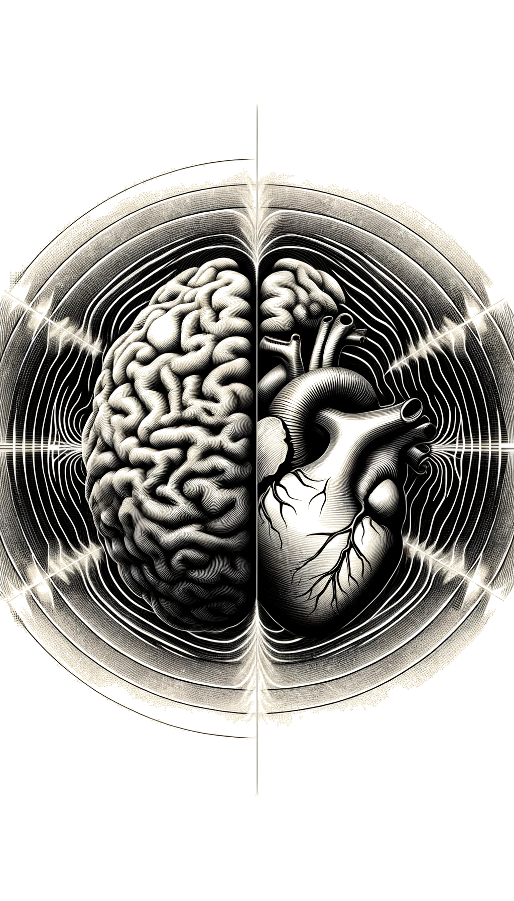
</p>


BrainBeats is an EEGLAB plugin to process and analyze EEG together with a cardiovascular signal (ECG or PPG) recorded at the same time, for brain-heart interplay research. It runs from its own entry in the EEGLAB menu bar or from the command line, and provides:

1. **Heartbeat-locked EEG** in three domains: time (heartbeat-evoked potentials, HEP), time-frequency (heartbeat-related spectral perturbations, HRSP) and phase (heartbeat-related phase consistency, HRPC), on scalp channels, independent components or both, with a surrogate heartbeat control, an optional regression-based baseline correction, and the cardiac field artifact measured (its removal optional, off by default)
2. **Heart rate variability (HRV) and EEG features** in the time, frequency and nonlinear domains

3. **Brain-heart coupling** between the slow fluctuations of EEG band power and heart rate variability, with respiration as an exogenous input: strength, direction (which signal leads) and direct vs mediated coupling (command line, see section 3)

The figures below come from the two sample datasets in `sample_data`, both 63-channel EEG, ECG and PPG at rest with eyes open, from [ds003838](https://nemar.org/dataexplorer/detail?dataset_id=ds003838): the heartbeat-locked EEG figures from `sub-047_rest.set` (5.3 min), which has a clearer heartbeat-evoked response, and the others from `dataset.set` (sub-032, 3.8 min, with added artifacts; the dataset of the tutorial). They are regenerated by `tests/make_readme_figures.m`.


## Installation

- MATLAB with the Signal Processing and the Statistics and Machine Learning toolboxes (Parallel Computing is optional, for 'parpool').
- [EEGLAB](https://github.com/sccn/eeglab) with the clean_rawdata, ICLabel and firfilt plugins (included by default). PICARD (fast ICA), REST (infinity reference) and GEDAI (artifact removal) are installed automatically when these options are selected.
- In EEGLAB: File > Manage extensions, search for BrainBeats, and install it. Or clone this repository into `eeglab/plugins`.
- Your data: one EEGLAB dataset with the EEG and heart channels recorded together.


## Quick start

Click **BrainBeats** in the EEGLAB menu bar. The window shows the current dataset (or loads one, or the sample dataset), and selects the analysis, the heart signal and channel(s), and, for HEP, whether the analysis is performed on the scalp channels, the independent components or both. **Next** opens the parameters of the analysis.

<p align="center" width="100%">
  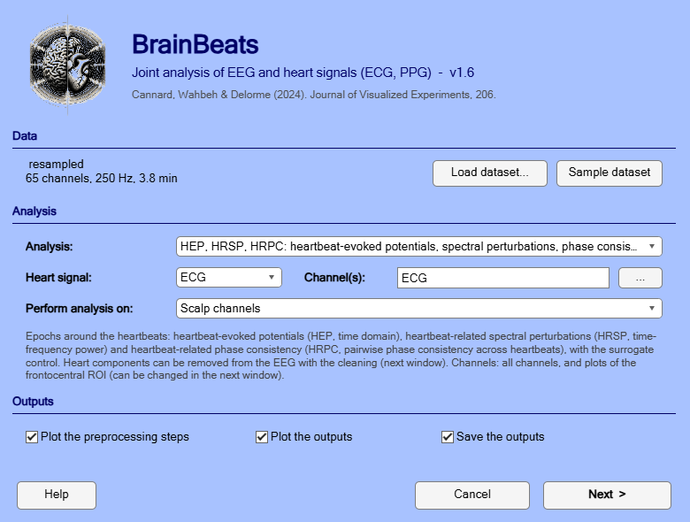
</p>

From the command line:

```matlab
eeglab; close
EEG = pop_loadset('filename','dataset.set','filepath', fullfile(fileparts(which('brainbeats_process')),'sample_data'));

% Window
[EEG, com] = pop_brainbeats(EEG);
```

Or without the window: HEP from the ECG channel, with EEG cleaning and 100 surrogate heartbeat trains. BrainBeats needs continuous data, so start from the loaded dataset, not from a HEP output. Outputs are saved next to the input file unless 'save' is false.

```matlab
EEG = pop_loadset('filename','dataset.set','filepath', fullfile(fileparts(which('brainbeats_process')),'sample_data'));
EEG = pop_select(EEG, 'nochannel', {'PPG'});    % only one type of heart signal
EEG = brainbeats_process(EEG, 'analysis','hep', 'heart_signal','ecg', ...
    'heart_channels',{'ECG'}, 'clean_eeg',true, 'hep_surrogates',100, 'save',false);
```

`brainbeats_tutorial.m` walks through every method with the sample data, and `help brainbeats_process` lists all options. Outputs are stored in `EEG.brainbeats` (parameters, heartbeats, signal quality, features, ROI or IC results, HRSP, surrogate results), and the command reproducing a GUI run is in the EEGLAB history (`eegh`).


## Overview

<p align="center" width="100%">
  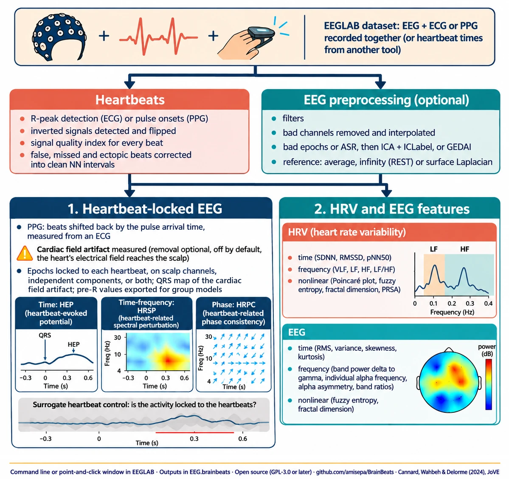
</p>

<sub>ASR: artifact subspace reconstruction. GEDAI: generalized eigenvalue de-artifacting instrument. HEP: heartbeat-evoked potential. HRSP: heartbeat-related spectral perturbation. HRPC: heartbeat-related phase consistency. HRV: heart rate variability. IAF: individual alpha frequency. ICA: independent component analysis. NN: normal-to-normal (cleaned) inter-beat intervals. PRSA: phase-rectified signal averaging. SDNN, RMSSD, pNN50: standard deviation, root mean square of successive differences, and share of successive differences > 50 ms of the NN intervals. SQI: signal quality index. VLF, LF, HF: very low, low and high frequency power.</sub>


## Heartbeat detection

All methods start from the heartbeats: R-peaks for ECG, pulse onsets ('valleys', default) or systolic peaks ('peaks') for PPG, or beat times detected with another tool ('heart_signal','rr' with 'beat_latencies' in s). Inverted signals are detected and flipped: ECG leads from the polarity of the QRS complexes, PPGs from the skewness of their slope (the systolic upstroke is the fast edge; most raw PPG outputs are light intensity, i.e. inverted, as all 14 of our test recordings). BrainBeats computes a signal quality index (SQI), flags ECG beats detected on the wrong wave (e.g. the T-wave), and corrects RR artifacts: a false beat is removed and its interval merged with the next one, an ectopic beat (a premature beat followed by a compensatory pause, each 20% away from the local median interval) is removed the same way, and missing beats are inserted in gaps. With several heart channels, the one with the fewest abnormal beats is used. PPG pulses are detected relative to the local pulse amplitude, so pulses are kept where the amplitude drops.

<p align="center" width="100%">
  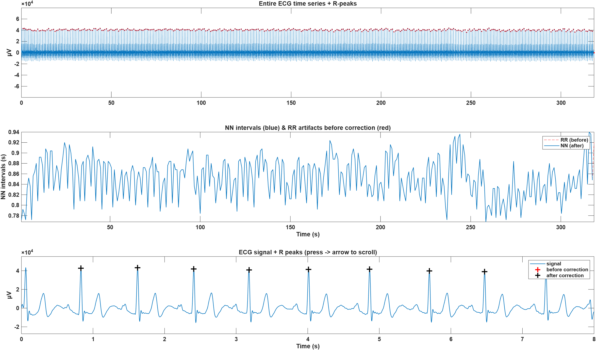
</p>
<p align="center"><em>ECG signal with the detected R-peaks, and the RR intervals before and after artifact correction (NN intervals).</em></p>


## EEG preprocessing

With 'clean_eeg' (on by default in the GUI):

- FIR filters: 0.5-30 Hz for HEP (the slow HEP components are kept; ICA is fitted on a 1-Hz high-passed copy), 1-40 Hz for features (the gamma band ends at 40 Hz); line noise notch; zero-phase or causal.
- Bad channels removed (clean_rawdata) and interpolated.
- Artifact removal ('clean_method'): bad epochs (HEP) or ASR (continuous data), then ICA and ICLabel ('asr_ica', default); or GEDAI ('gedai'; Ros et al., 2025), which removes artifacts from the continuous data without ICA (installed from the EEGLAB extension manager if needed; noncommercial license).
- Reference ('ref'): average (default), infinity (REST), surface Laplacian ('csd', current source density with spherical splines; applied after the artifact removal, since ICLabel needs average-referenced data; channels must have 10-05 labels), or none.


## 1. Heartbeat-locked EEG: HEP, HRSP, HRPC

- EEG epochs from -300 to 600 ms around each heartbeat ('hep_window'), time-locked to the heartbeats kept after RR correction. Heartbeats followed by the next one before the end of the epoch + 50 ms are rejected, so no epoch contains the next QRS, as are outlier inter-beat intervals. 'hep_window','adaptive' sets the epoch end from the subject's heart rate (within-subject analyses only).
- No baseline correction by default: the pre-R-peak window holds activity of the previous cardiac cycle, and the recent methods review of Steinfath et al. (2026) recommends reporting HEPs without baseline correction and testing the baseline window. Optional regression-based baseline correction ('hep_baseline','regression'; Alday, 2019; window [-150 -50] ms, which ends before the QRS onset): the baseline is a trial-level regressor instead of being subtracted.
- HRSP and HRPC (pairwise phase consistency across heartbeats) from 4 to 30 Hz, with 5-cycle Morlet wavelets applied to the continuous data. HRSP is expressed relative to the whole cardiac cycle. HRPC is the pairwise phase consistency across heartbeats (Vinck et al., 2010), unbiased by the number of heartbeats. The cardiac cycle includes the QRS complex, whose broadband field is in every epoch: where it is large, latencies away from it show a power decrease relative to the cycle, which the surrogate control finds significant too (synthetic transient 5 times the noise SD: -1.7 dB at 350-600 ms; none at 2 times). Normalizing by the mean power of the continuous data gives the same (it contains every QRS): check the heart-locked amplitudes below.
- Where ('hep_level'): on all channels ('channels', default; plots of the average of a channel ROI, 'hep_roi', default frontocentral: F1-F4, Fz, FC1-FC4, FCz, C1-C4, Cz), on the independent components ('ics'), or both ('both'). The three measures and the surrogate control are computed the same way in both cases.
- Independent components: the HEP, HRSP, HRPC and surrogate control of every IC left after the cleaning (of the cleaning ICA, or of an ICA run for this), exported with their scalp maps and ICLabel classes; the IC numbers are those of the decomposition, and the ICs removed by the cleaning are listed. BrainBeats does not select ICs: whether a heartbeat-locked brain response can be separated from the cardiac field artifact is not established, and on the sample data the most heartbeat-locked ICs also followed the ECG's QRS or T-wave.
- Surrogate heartbeat control ('hep_surrogates', e.g. 100): one surrogate beat is drawn at a random position in each inter-beat interval, so the surrogate beats fall at random cardiac phases. The HEP, HRSP and HRPC at each latency are compared with the surrogates (FDR-corrected). This is a check of heartbeat locking: the cardiac field artifact is heartbeat-locked too, so it does not show a neural origin, and it does not compare conditions. 'hep_surrogate_mode','rigid' shifts the whole train instead (Park et al., 2018): a shifted train is still heartbeat-locked, so its band spans the HEP's own range.
- PPG: the pulse reaches the sensor after the heartbeat (pulse arrival time), so the PPG beats are shifted back by it ('ppg_transit','auto'), measured from an ECG channel of the file. Without an ECG, give the delay in ms (e.g. measured with an ECG on the same device and sensor site), or 'eeg' to estimate it from the cardiac field artifact of the EEG, which precedes each pulse by that delay: check its figure. On 6 subjects of ds003838 (pulse onsets at the finger, 92-112 ms after the R-peak), the ECG-based correction recovered the ECG-locked HEP (r = .68-.92; .16-.39 without it), the EEG estimate was right on 3, wrong on 1 (by 300 ms) and not clear enough on 2, and a fixed 250 ms did not fit any: there is no silent estimate without an ECG.

The cardiac field artifact is not removed by default, and can remain after any removal method (see Heart artifact below), around the QRS and over the T wave (~200-400 ms), the usual HEP window. The heart-locked EEG amplitude before and after the cleaning is printed and stored in EEG.brainbeats.preprocessings for both windows: -50 to 100 ms (cfa_before, cfa_after) and 200 to 500 ms (cfa_late_before, cfa_late_after), the latter including any neural HEP. Check them before interpreting HEP effects.

<p align="center" width="100%">
  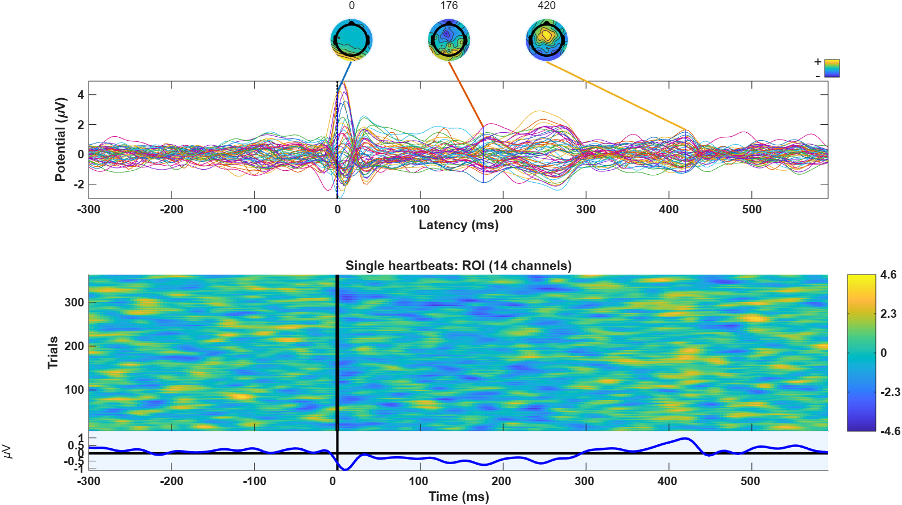
</p>
<p align="center"><em>HEP from the ECG (cleaned EEG): all electrodes with scalp maps at the R-peak (cardiac field artifact) and at the largest deflections of the ROI HEP at 150-350 ms and after 350 ms (top), and single heartbeats of the frontocentral ROI (bottom).</em></p>

<p align="center" width="100%">
  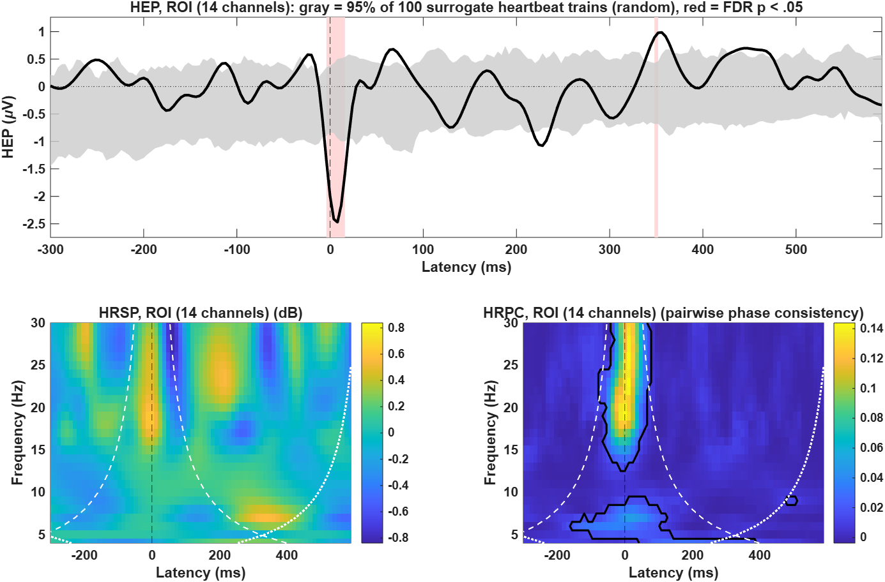
</p>
<p align="center"><em>Frontocentral ROI: HEP against 100 surrogate heartbeat trains (gray: 95% of the surrogates; red: FDR-corrected p < .05), HRSP (dB relative to the cardiac cycle) and HRPC, with the FDR contours. Dashed white lines: ±2 SD of the wavelets around the R-peak, where the time-frequency values include the QRS. Dotted white lines: the same for the nearest previous and next heartbeats. Here the HEP exceeds the surrogates at the QRS, at 130-200 and 240-260 ms, and at 390-430 ms (+1 µV, after the end of the T wave at ~300 ms; largest at Fz, F1, FC2 and Cz, not at the frontal pole).</em></p>

<p align="center" width="100%">
  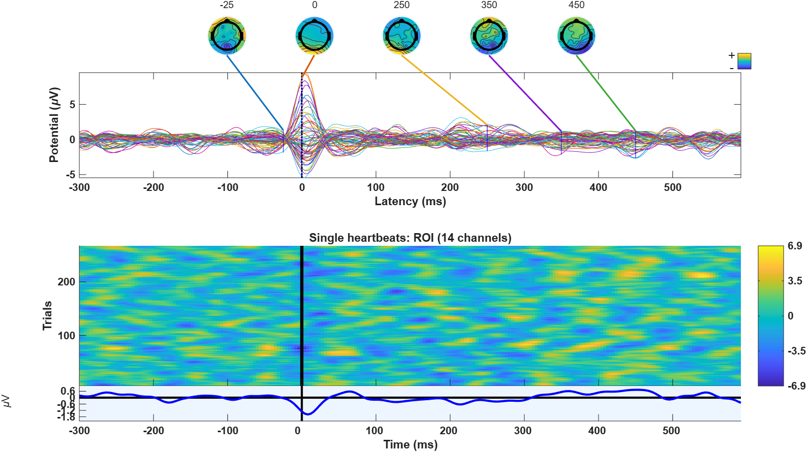
</p>
<p align="center"><em>HEP from the PPG, with the beats shifted back by the pulse arrival time measured from the ECG of the file.</em></p>

<p align="center" width="100%">
  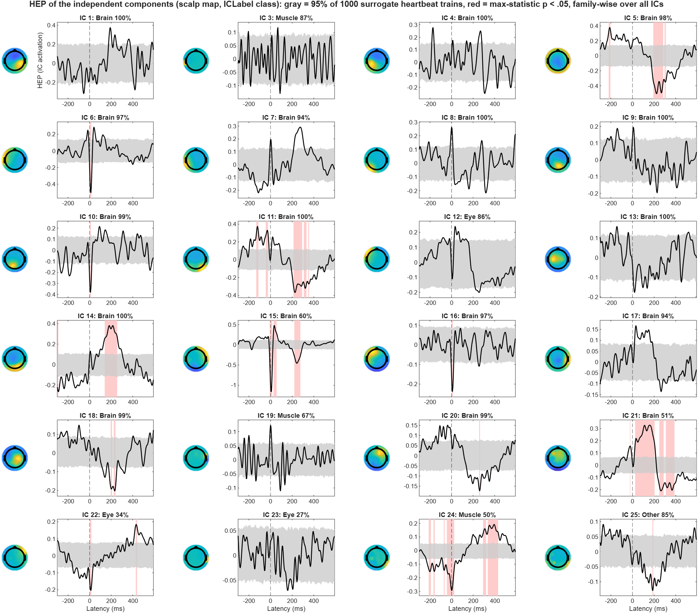
</p>
<p align="center"><em>Independent components ('hep_level','ics'), ECG: scalp map, ICLabel class and HEP of each IC left after the cleaning (the first 24; ICs 6 and 10, eye, were removed), against 100 surrogate heartbeat trains (gray: 95% of the surrogates; red: FDR-corrected p < .05). Some ICs follow the QRS complex and the T wave (e.g. ICs 20 and 24, classified 'Other'): cardiac field artifact that ICLabel did not classify as heart.</em></p>

<p align="center" width="100%">
  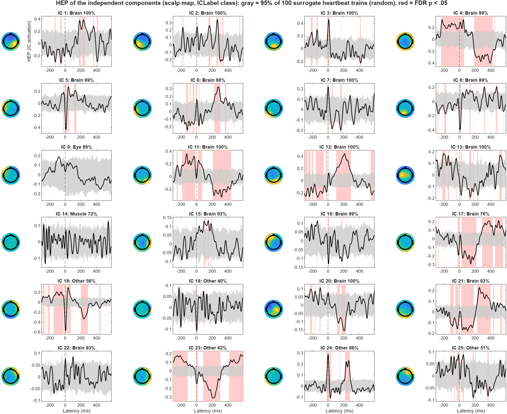
</p>
<p align="center"><em>The same from the PPG (beats shifted back by the pulse arrival time). The ICA is fitted on the epochs of this run, so the IC numbers differ from the ECG run.</em></p>


### Heart artifact

The electrical field of the heart reaches the scalp (cardiac field artifact) and is time-locked to the heartbeat, like the HEP. In the HEP analysis, 'heart_removal' sets whether the EEG cleaning removes it. **The default is 'none', and we recommend keeping it**: on our test data, every method either found nothing to remove or also removed heartbeat-locked brain activity (table below). The methods are there to compare and to check results, not as a correction:

- 'ica': the independent components (ICs) that ICLabel classifies as heart ('conf_thresh', default 0.75) are removed with the other artifact ICs.
- 'ica_caracas': the ICs that CARACAS classifies as cardiac (Champetier et al., 2025: R waves detected in each IC's time course; no ECG needed). Needs the SASICA plugin (`git clone --recurse-submodules https://github.com/dnacombo/SASICA` into `eeglab/plugins`). It runs on the continuous data, without the stretches of large artifacts.
- 'ica_ecg' (ECG): the ICs whose time course correlates with the ECG (|r| ≥ 'ecg_corr', default 0.6, as in SASICA). The correlations are stored in EEG.brainbeats.preprocessings.heart_ics.
- 'ecg_regression' (ECG, no ICA): the ECG, filtered like the EEG and shifted by -20 to +20 ms, is regressed out of each EEG channel. The fit uses the samples without large EEG artifacts.
- 'ssp' (ECG): the first 'ssp_n' (default 2) scalp topographies of the heartbeat-locked average EEG are projected out of the data (signal-space projection, as MNE's compute_proj_ecg). The projection removes these topographies at all times, brain activity included.

The heart-locked EEG amplitude is printed and stored in EEG.brainbeats.preprocessings before and after the cleaning, around the QRS (-50 to 100 ms: cfa_before, cfa_after) and from 200 to 500 ms (cfa_late_before, cfa_late_after; this window also holds any neural HEP). Check them before interpreting HEP effects.

On 6 subjects of ds003838 (resting state, 63 channels, ~3 min each; `tests/compare_heart_removal.m`, which also adds a synthetic 1-µV response 300 ms after each R-peak on the frontocentral channels and measures how much of it is left):

| | Heart-locked amplitude removed (-50 to 100 ms) | Synthetic response kept (vs no removal) |
|---|---|---|
| 'ica' | 0% on all 6 (ICLabel found no heart IC) | 100% |
| 'ica_caracas' | 0% on all 6 (no IC classified as cardiac; on the sample data, the IC most correlated with the ECG failed only the skewness criterion) | 100% |
| 'ica_ecg' | 0% on all 6 (no IC reached \|r\| = 0.6; 0.55 at most on the sample data) | 100% |
| 'ecg_regression' | 29% on average (3-70%; ~70% where the artifact was largest, ~2 µV) | 80% on average (54-100%) |
| 'ssp' | 52% on average (27-73%) | 57% on average (39-76%) |
| ICA with the ECG channel (former 'rm_heart', removed in v1.6) | 19% (0-47%) | 7% on average (5 of 6 near 0%) |

The methods that remove part of the artifact also remove heartbeat-locked brain activity, and the methods that select ICs found none to remove in these recordings (short, low artifact amplitude). The synthetic response is idealized (perfectly heartbeat-locked, fixed topography), so real losses may be smaller, but nothing tells the methods apart from a real HEP. In patients with an isoelectric EEG (no brain activity, so any heartbeat-locked signal is artifact), the artifact varied widely between patients and was not predicted by their ECG, possibly because it includes pulse-related movement; compared with controls, removing heart ICs weakened the HEP effect, and the surface Laplacian removed an effect that depended on the reference (Kandasamy et al., 2026, preprint).

The cardiac field artifact is not a constant either. Breathing rotates the electrical axis of the heart and changes the impedance of the thorax, so the ECG, and the artifact, change over the respiratory cycle (the basis of ECG-derived respiration; Moody et al., 1985). Heart rate moves the T wave (the QT interval shortens as heart rate rises), and stroke volume and body position change the artifact too: the heartbeat-evoked MEG response co-varied with stroke volume from beat to beat only when the cardiac artifact was not corrected (Buot et al., 2021). So conditions that differ in breathing, heart rate, stroke volume or posture can produce HEP differences without any difference in brain activity, whether the artifact is removed or not. Instead of relying on a removal method:

- compare the ECG between conditions: its heartbeat-locked average, heart rate and, if recorded, breathing;
- check the heart-locked amplitudes reported above, and whether an effect overlaps the QRS or the T wave of the ECG;
- use the surrogate heartbeat control ('hep_surrogates') for heartbeat locking, and the surface Laplacian ('ref','csd'), which attenuates the broad cardiac field relative to local activity;
- for condition contrasts, use a surrogate-heartbeat correction (Steinfath et al., 2026) or, in task data, a pseudotrial correction (doi:10.1162/IMAG.a.30).


## 2. EEG and HRV features

From the continuous data:

- HRV time domain: SDNN, RMSSD, pNN50
- HRV frequency domain: ULF, VLF, LF and HF power (ms²), LF/HF ratio, relative power ('hrv_norm'); Lomb-Scargle periodogram by default, 'welch' or 'fft' on the NN series resampled at 7 Hz, or 'LombScargle_norm' (unitless, divided by the variance of each window: its values grow with the heart rate)
- HRV nonlinear domain: Poincaré (SD1, SD2, SD1/SD2), fuzzy entropy, fractal dimension, PRSA acceleration and deceleration capacities (Bauer et al., 2006; anchors whose interval changes by more than 20% are left out, 'prsa_thresh'. Bauer et al. used 5% on 24-h recordings, which left out 18-61% of the anchors and halved the capacities on our 3-min resting recordings, so the values are not comparable with their risk cut-offs)
- EEG time domain: RMS, variance, skewness, kurtosis, IQR
- EEG frequency domain: band power (delta 1-4, theta 4-8, alpha 8-13, beta 13-30, gamma 30-40 Hz, each from its lower edge up to its upper edge; optionally individualized from the alpha peak), individual alpha frequency (IAF, alpha center of gravity) and peak alpha frequency, alpha asymmetry (ln right - ln left alpha power, e.g. F4 - F3: positive values mean relatively more left-hemisphere activity; each left electrode paired with its mirror position), absolute and relative power, band ratios, median and 90% spectral edge frequencies
- EEG nonlinear domain: fuzzy entropy, fractal dimension

<p align="center" width="100%">
  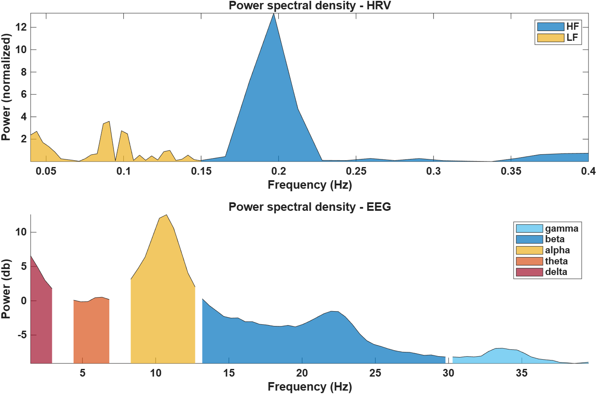
</p>
<p align="center"><em>Power spectral density of the HRV (ms²/Hz) and of the EEG (dB, 20% trimmed mean across channels), with the frequency bands used and the individual alpha frequency (IAF).</em></p>

<p align="center" width="100%">
  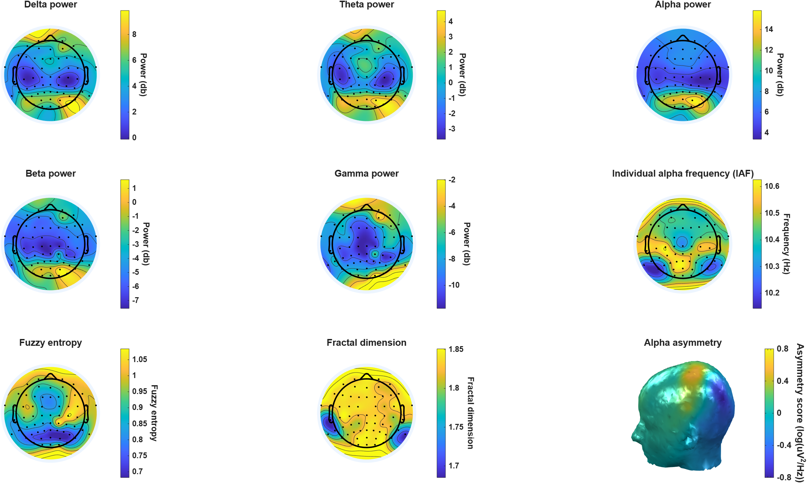
</p>
<p align="center"><em>EEG features on the scalp: band power, IAF, fuzzy entropy, fractal dimension and alpha asymmetry.</em></p>


## 3. Brain-heart coupling

`'analysis','coupling'` (command line; `'coherence'` is accepted as an alias) measures how the slow fluctuations of EEG band power and of the heart period drive each other, at the time scales of heart rate variability (LF 0.04-0.15 Hz, HF 0.15-0.4 Hz).

```matlab
EEG = brainbeats_process(EEG,'analysis','coupling','heart_signal','ecg','heart_channels',{'ECG'}, ...
    'coupling_resp','RESP','clean_eeg',true);
EEG.brainbeats.coupling.table
```

**Series.** After cleaning, the heartbeat-locked average EEG (cardiac field artifact and heartbeat-evoked potential) is removed, so that EEG power does not follow the number of beats (`'coupling_cfa'`: 'evoked' default, 'ssp', 'both', 'none'). Then one sample per heartbeat, as in cardiovascular variability analysis: the NN interval, the mean power of each EEG band (delta, theta, alpha, beta) per region (frontal, central, temporal, posterior by default) over that interval, and respiration over that interval. Respiration comes from a respiration channel, from the ECG (the R-S amplitude of each QRS), from the PPG (pulse baseline and pulse amplitude), from several of these at once, or is absent (`'coupling_resp'`; 'auto': a respiration channel, else the ECG, else the PPG). With a PPG, the pulse arrival time and pulse amplitude can be modelled next to the heart period (`'coupling_vascular'`). A PPG series that would cut the usable data by more than half (a poor PPG) is left out with a warning.

**Model.** For each region, one vector autoregressive model of the bands and the heart period, with respiration as an exogenous input that drives both. Lag orders are chosen by BIC for each equation, separately for each series' own past and for the others' past.

**Measures** (one row per region, band, direction and measure in `.table`):

| Question | Measures |
|---|---|
| Is there coupling, how strong? | Granger causality (GC) in the time domain and in LF and HF (state-space, Barnett & Seth 2015); coherence |
| Which way? | GC EEG -> heart and heart -> EEG, each with its own test; time-reversed GC as a check |
| Direct, or through respiration or other bands? | conditional GC (given the other bands and respiration) next to pairwise GC (band and heart alone); partial coherence next to coherence; generalized partial directed coherence (direct) next to directed coherence (total) |
| Beyond linear-Gaussian? | Gaussian-copula conditional transfer entropy (rank-based) |
| Respiration | respiration -> heart and -> each band; coherence of respiration with the heart period (does the signal track breathing?) |

Tests: F-tests (with a heteroskedasticity-robust covariance, HC3, and the degrees of freedom reduced for the detrending of each run of clean data), a parametric bootstrap of the conditional GC (`'coupling_nboot'`, default 200: the fitted model without the tested link, driven by the recorded respiration), and circular shifts for the transfer entropy. `q`: false discovery rate (Benjamini-Hochberg) over the ~32 conditional EEG <-> heart tests of a recording. Directed coherence and GPDC are ratios that change with the variables in the model: compare them only between identical models; GC has no such normalization.

**Report.** A one-page figure and a plain-language summary (`.report`, saved as `_coupling_report.png` with the results): per region, the links that survive the FDR (solid arrows, colour = LF, HF or both, width = GC) and those seen only without conditioning (dashed: mediated by respiration or the other bands); the strongest links; quality checks (does the respiration track breathing, are the model residuals white, enough samples per coefficient, cardiac field removed, chance level); and warnings (e.g., beta links with muscle activity).

<p align="center" width="100%">
  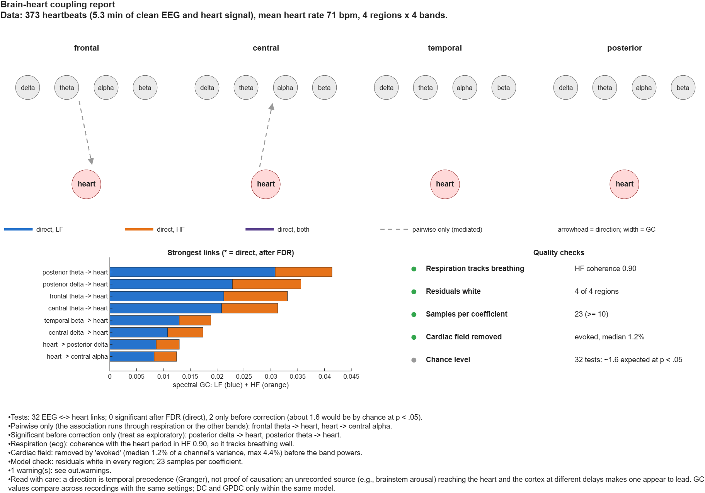
</p>
<p align="center"><em>Coupling report of the sample recording (sub-047, resting state, respiration from the ECG).</em></p>

**Validation** (`tests/`). `test_coupling_engine` checks the state-space GC against long regressions and known models. `test_coupling_sim` simulates EEG, ECG and respiration with a known coupling (`sim_brainheart`: heartbeats from an integral pulse frequency modulation model, respiration driving both heart rate and EEG power, a cardiac field in the EEG). On 200 simulated 5-min recordings per scenario:
- Respiration driving both alpha power and heart rate, no direct link: the conditional F-tests rejected 5.3% of 3,200 tests at p < .05 (400 recordings, 4 bands, both directions; 6-7% per direction for alpha and beta on another 200), transfer entropy 4-10%, pairwise GC up to 86%, and 20% without respiration in the model. Conditioning on respiration is what makes the direct links interpretable.
- A planted alpha -> heart or heart -> alpha link was detected in 100% and 98% of the recordings, the reverse direction in 7%.
- The cardiac field (classical F-test): without it in the simulation, beta <-> heart rejected 3-4%; with it and the default removal ('evoked'), heart -> beta 8-9% (7% with the robust test). 'both' (SSP + evoked) brought every test to 3-6% but lowered power (92% and 70%) because SSP also removes brain activity with the cardiac field's topography (13 simulated channels).

On real data, two nulls with each series' own structure kept and no coupling left: in a dataset of 38 participants with ECG and a respiration belt (18 x 90 s each), the EEG of one segment paired with the heart and respiration of another (2,432 tests); in ds003838, the EEG of one resting recording paired with the heart and ECG-derived respiration of another (3,840 tests). The conditional tests were at p < .05 in 5.8% [95% CI 4.5-7.2] and 5.8% [4.8-6.9] of them, and a model had an FDR-significant link (q < .05) in 7% and 10%. With the classical F-test, 6.1% and 7.2%: real EEG power and heart-period residuals are heteroskedastic, hence the robust test. The real pairing of the belt dataset gave 24%. In ds003838 (61 resting recordings, 64 channels, ECG and PPG; 3 more had too little clean data), conditional EEG -> heart and heart -> EEG tests were at p < .05 in 4-11% per band and direction (8% overall, 60 recordings): little coupling at rest beyond respiration, which drove the heart period in 93% of the tests. The cardiac field options gave the same rates there (classical F-test; heart -> beta: 8.6% 'evoked', 8.2% 'none', 14.3% 'both'), so 'evoked' is the default. The comparisons below (respiration proxies, PPG) were also made with the classical F-test.

**Respiration without a respiration channel.** Against the belt (38 participants), the ECG-derived respiration had a median coherence of 0.69 (below 0.5 in 10), and the significant links agreed in 89% of the tests (kappa 0.72; GC values r = 0.80): usable, but check its coherence with the heart period in the report. In ds003838, the ECG and PPG proxies tracked the respiratory heart-rate oscillation about equally (HF coherence with the heart period, median: ECG 0.87, PPG amplitude 0.86, PPG baseline 0.73); using all three raised respiration -> heart from 95% to 98% of the tests but did not change the EEG <-> heart results.

**PPG pulse arrival time and amplitude** (`'coupling_vascular'`, off by default). In ds003838 the model captured the cardiovascular loop (heart period -> pulse arrival time in 97% of the tests, respiration -> pulse arrival time 92%, pulse arrival time -> heart period 38%, as through the baroreflex), but EEG <-> pulse arrival time or amplitude stayed at 2-10%, within chance, while the two extra series halved the samples per coefficient and their residuals were not white in about a third of the models. They answer vascular questions; they do not sharpen the EEG <-> heart estimates.

**Read with care.** A direction from scalp data can be a third, unrecorded source that reaches the heart and the cortex at different delays (e.g., arousals, seizures): say "precedes", not "drives". Without a respiration channel, HF coupling may be the respiratory drive of both. Beta-band links can be scalp muscle activity, which follows arousal like the heart rate.


## Tutorials

- `brainbeats_tutorial.m` (command line, all methods, sample data)
- JoVE article (v1.4): https://www.jove.com/t/65829/brainbeats-as-an-open-source-eeglab-plugin-to-jointly-analyze-eeg
- JoVE video: https://www.jove.com/v/65829/author-spotlight-advancing-study-brain-heart-interplay-with

The JoVE tutorial describes v1.4: the menu, some defaults and results have changed since (see the version history).


## Version history

v1.6 (11/2026) - Many fixes and a few additions (see below). Results of some features change:
- BrainBeats now has its own entry in the EEGLAB menu bar (was Tools > BrainBeats). It opens a main window (dataset, which can also be loaded there, analysis, heart signal and channels, IC measures for HEP), then the parameters of the analysis. Heart artifact removal is an option of the HEP analysis there ('heart_removal', off by default: ICA with ICLabel, CARACAS or the ECG correlation, ECG regression, or SSP, see Heart artifact; the separate 'rm_heart' analysis was removed, see below), unused options were removed (e.g. the PPG 'learning period', which no code used), and the command line of a GUI run in the EEGLAB history now includes every option.
- Heartbeats: improved R-peak detection and correction (get_RR, clean_rr: a removed false beat now merges its interval with the next one; missing beats are inserted in gaps), per-electrode outputs with several heart channels, new R-peak QA report (rpeak_qa: flags beats detected on the wrong wave, e.g. T-wave), ECG artifact detector (detect_ecg_artifacts), PPG 'ppg_detect_mode' ('valleys' or 'peaks'). Ectopic beats (premature beat then compensatory pause) are now removed and replaced by a beat in the middle of the merged interval: they passed the RR cleaning before (6 injected premature beats raised RMSSD from 36.5 to 83.2 ms; 36.5 ms after cleaning). Inverted PPGs (light intensity, the raw output of most devices, and of all our test recordings) are detected and flipped, so 'valleys' are the pulse onsets: before, they marked the systolic peaks of such recordings (~400 ms after the R-peak instead of ~100 ms). PPG pulses are detected with a prominence relative to the local pulse amplitude (a global height threshold missed the low-amplitude pulses: 301 instead of 306 beats on the sample data).
- New regression-based baseline correction of HEP epochs ('hep_baseline','regression'; Alday, 2019): the baseline is used as a trial-level regressor instead of being subtracted, and the corrected epochs are stored in the output dataset, ready for further analyses (BASELINE_REGRESSION can also be called directly with condition labels).
- New 'rr' heart signal: provide beat times detected elsewhere ('beat_latencies', in s) for HEP or HRV features.
- EEG preprocessing: new GEDAI artifact removal ('clean_method','gedai'). The infinity reference ('ref','infinity') and the surface Laplacian ('ref','csd') work: both silently fell back to the average reference (REST could not find its files when EEGLAB had not added its subfolders; CSD was missing). The surface Laplacian is applied after the artifact removal. For HEP, the high-pass is now 0.5 Hz by default (was 1 Hz), and ICA is fitted on a 1-Hz high-passed copy of the data.
- HEP: epochs are now -300 to 600 ms by default ('hep_window'; was -300 to 700 ms), and heartbeats followed by the next one before the epoch end + 50 ms are rejected, so no epoch contains the next QRS (with -300 to 700 ms and a 550 ms limit, 28% of the sample-data epochs did). 'hep_window','adaptive' sets the epoch end from the subject's heart rate, for within-subject analyses. The inter-beat-interval rejection now actually removes trials (all events were epoched before), epochs are time-locked to R-peaks only (not to other events in the file), and to the beats kept after RR cleaning.
- HRSP (heartbeat-related spectral perturbations; was 'HEO') and new HRPC (heartbeat-related phase consistency: the pairwise phase consistency across heartbeats, unbiased by their number): zero-phase 5-cycle Morlet wavelets, 4-30 Hz, applied to the continuous data and indexed at the same heartbeats as the HEP epochs; HRSP is expressed relative to the whole cardiac cycle (the pre-R-peak baseline overlapped the QRS once smeared by the wavelets). They are computed for all channels (EEG.brainbeats.hrsp), plotted for the average of a channel ROI (default frontocentral, 'hep_roi'), and computed for all independent components with 'hep_level' 'ics' or 'both'.
- Surrogate heartbeat control ('hep_surrogates', e.g. 100): surrogate heartbeats at random cardiac phases (or the whole train rigidly shifted by up to +/-500 ms, 'hep_surrogate_mode','rigid'; Park et al., 2018), and the HEP, HRSP and HRPC at each latency are compared with the surrogates (z-scores, FDR-corrected p-values, with an exponential tail for HRPC; EEG.brainbeats.surrogate). With EEG cleaning, the continuous data get exactly the same cleaning as the epochs.
- HEP baseline: none by default, as recommended by Steinfath et al. (2026); the regression baseline window is now [-150 -50] ms (was [-300 -100]). With 'keep_heart', the heart channel is added after the EEG cleaning and keeps its units (it went through the ICA and was rescaled).
- PPG: HEPs are time-locked to the heartbeats rather than to the pulses ('ppg_transit', 'auto' by default): the pulse arrival time is measured from an ECG channel of the file (ESTIMATE_PAT); without an ECG it must be given (a delay in ms, or 'eeg' for the estimate from the cardiac field artifact of the EEG, ESTIMATE_PAT_EEG). On the sample data, the arrival time to the pulse onsets was 112 ms with the ECG and 104 ms from the EEG, and the PPG-based HEP correlated with the ECG-based HEP at r = 0.92 after correction (r = 0.39 before).
- EEG band power: theta, alpha, beta and gamma used wrong frequency edges (bin indices instead of Hz); fixed. Bands now join (delta 1-4, theta 4-8 Hz, each band from its lower edge up to its upper edge): the bins between 3 and 4 Hz and between 7 and 8 Hz belonged to no band, and the relative powers did not sum to 1. Alpha asymmetry is now ln(right) - ln(left), the usual convention (it was left - right: the sign of earlier values is reversed). The time-domain 'mode' (meaningless on continuous signals) was removed, and the qEEG peak alpha frequency is named 'paf' (was 'iaf', which is the center of gravity in frequency.IAF). The 'individualized' band option works again: alpha is bounded by the individual alpha peak (median across channels), with the theta and beta edges moved accordingly (the band limits used are in frequency.bands). IAF threshold (restingIAF) restored to log10. Alpha asymmetry pairs each left electrode with its mirror position (it could pair C3 with T8), and its 'asy_norm' option now divides alpha by each channel's total power. Entropy features are computed at the actual resampled rate.
- HRV: pNN50 is now in % (was a fraction rounded to one decimal), PRSA acceleration/deceleration capacities follow Bauer et al. (2006) (were the mean NN at the anchors), LF/HF is no longer divided by total power with 'hrv_norm'. Band powers: the default is now the Lomb-Scargle periodogram in ms² ('LombScargle'; was the normalized periodogram, 'LombScargle_norm', unitless, whose values were multiplied by 1e6 and labelled ms² in v1.5). The normalized periodogram divides each window by its variance, and LF and HF come from windows of different lengths, so its band values are not comparable between bands, and they grow with the heart rate (same modulation in ms: LF +41% at 90 vs 60 bpm, ms² -3%). The periodogram is computed on a finer frequency grid (it had ~2 points per HF peak, which made the band integral and the plotted spectrum coarse). the mean NN is removed before Welch/FFT (it inflated LF and HF), the 'fft' method works (it crashed), and recordings shorter than 34 s return NaN band powers instead of crashing.
- ECG/PPG signal quality: windows where the two detectors agree on no beat now count as bad (were ignored); the PPG SQI now covers the whole recording (only the last 30 s were kept), is computed on the filtered PPG, and the bad portion is the beats of unacceptable quality (Li & Clifford, 2012) rather than an SQI below .9, which also flagged normal long beats: 1% instead of 33% on the clean sample PPG.
- Brain-heart coherence: the MVAR model is now fitted to the data before computing the coherence measures (the data were passed as model coefficients). It stays experimental and command-line only: the heart signal holds almost no heart rate variability in the bands analyzed.
- EEG features: with 'clean_eeg' on the command line, the default low-pass is now 40 Hz, as in the GUI (it was 30 Hz, under the 30-40 Hz gamma band), and the ASR cutoff 30 SD, as in the GUI (it was 50). 'eeg_norm',2 now gives the relative power, and band values are no longer rounded to 3 decimals.
- License: the plugin header now says GPL version 3 or later, as the LICENSE file (it said version 2 or later). GEDAI (noncommercial license) is no longer installed without asking in the MATLAB desktop.
- Command line: failed input checks and unknown inputs now raise errors, inputs of earlier versions and cleaning options without 'clean_eeg' give a warning, the BrainBeats version is stored with the parameters and the features file holds them too.
- Heart artifact: the heart-locked EEG amplitude is now also reported from 200 to 500 ms, and for every removal method. As in v1.5, the heart artifact is not removed by default in the HEP cleaning: on 6 test subjects, every method found nothing to remove or also removed a synthetic heartbeat-locked brain response (see Heart artifact). New removal options to compare: CARACAS (SASICA plugin), ICs correlated with the ECG, ECG regression, and SSP.
- The 'rm_heart' analysis was removed: ICA with the ECG channel (and ICLabel) removed most of a synthetic heartbeat-locked brain response on 5 of 6 test subjects (ds003838), so it can remove the HEP itself. Heart artifact removal is part of the HEP cleaning ('heart_removal').
- Command line: 'icamethod' (or 'ica_method'), 'conf_thresh', and get_RR options are now parsed; 'parpool','off' and 'eeg_features'/'hrv_features','off' work; parallel pool uses the 'Processes' profile and no longer changes your saved parallel settings. Runs under 'matlab -batch' no longer block on dialogs or the progress bar.
- GUI: new HEP options (epoch window, baseline correction, ROI, HRSP/HRPC, surrogate control, and the PPG pulse arrival time); reference and filter-type choices were mapped to the wrong options in some modes (fixed).
- Figures: toolbars hidden and figures drawn right away in recent MATLAB versions (they stayed blank during ICA); the bad-epochs plot shows the rejected epochs with their own events and automatic scaling. New figure of the independent components at the IC level (scalp map, ICLabel class, and HEP against the surrogates of each IC). The HEP figure shows scalp maps at the R-peak and at the largest early (150-350 ms) and late (after 350 ms) deflections of the ROI HEP.
- Second sample dataset, `sample_data/sub-047_rest.set` (another participant of ds003838, 5.3 min, without added artifacts), with a clearer heartbeat-evoked response: the README HEP figures are made from it. `dataset.set`, used by the tutorial, is unchanged.

v1.5 (5/2/2024) - METHOD 4 (brain-heart coherence) added

v1.4 (4/1/2024) - publication JoVE (methods 1, 2, 3)

## When using BrainBeats, please cite:

Cannard, C., Wahbeh, H., & Delorme, A. (2024). BrainBeats as an Open-Source EEGLAB Plugin to Jointly Analyze EEG and Cardiovascular Signals. Journal of visualized experiments: JoVE, (206).


## BrainBeats was used or cited in:

Abdollahpour, N., & Artan, N. S. (2025). Significant interactions in infant operculum regions when exposed to a bilingual environment: a resting-state fNIRS study. Neurophotonics, 12(4), 045012-045012.

Abdullah, J.et al. (2025). Mathematical Decoding of the Correlation Between Different Organs' Activities: A Review. Fractals, volume 33, issue: 09.

Liu, P., Gao, Y., Ballegaard, M., & Puthusserypady, S. (2025, July). A Novel Framework for Real-Time ECG and Blood Pressure Signal Analysis: Enhancing Accuracy and Interaction through Dynamic Quality Evaluation. In Annual International Conference of the IEEE Engineering in Medicine and Biology Society. IEEE Engineering in Medicine and Biology Society. Annual International Conference (Vol. 2025, pp. 1-7).

Carbone, F., Silva, M., Leemann, B., Hund-Georgiadis, M., & Hediger, K. (2025). Registered Report Stage I: Neurological and physiological effects of animal-assisted treatments for patients in a minimally conscious state: a randomized, controlled cross-over study. Neuroscience.

Balasubramanian, K. et al. (2025). Complexity Measures in Biomedical Signal Analysis: A Clinically-Grounded Survey Across EEG, ECG, Intracranial Pressure, and Photoplethysmogram Modalities. IEEE Access.

Remiszewski, M. (2025). Long-term Aerobic Exercise Enhances Interoception and Reduces Symptoms of Depression and Anxiety in Physically Inactive Young Adults: A Randomized Controlled Trial. Psychology of Sport and Exercise, 102939.

Chowdhury, et al. (2025). Neural Signals, Machine Learning, and the Future of Inner Speech Recognition. Frontiers in Human Neuroscience, 19, 1637174.

Naaz, R., & Ahmad, S. (2025). ECG Data Mining Approach for Detection of Arrhythmia Using Machine Learning. In 2025 3rd International Conference on Device Intelligence, Computing and Communication Technologies (DICCT) (pp. 52-57). IEEE.

Cheng, X., Maess, B., & Schirmer, A. (2025). A Pleasure That Lasts: Convergent neural processes underpin comfort with prolonged gentle stroking. Cortex.

Georgaras, E., & Vourvopoulos, A. (2025). Physiological assessment of brain, cardiovascular, and respiratory changes in multimodal motor imagery brain-computer interface training. Research in Biomedical Engineering and Technology, 12(1), 2471680.

Park, S., Ha, J., & Kim, L. (2025). Improving single-trial detection of error-related potentials by considering the effect of heartbeat-evoked potentials in a motor imagery-based brain-computer interface. Computers in Biology and Medicine, 195, 110563.

Perez, T. M., Drake, E., & Sullivan, S. (2024). Assessing central nervous system and peripheral nervous system functioning in resting and non-resting conditions in a healthy adult population: A feasibility study. Chiropractic Journal of Australia (Online), 51(1), 1-32.

Akuthota, S., Rajkumar, K., & Janapati, R. (2024). Intelligent EEG Artifact Removal in Motor ImageryBCI: Synergizing FCIF, FCFBCSP, and Modified DNN with SNR, PSD, and Spectral Coherence Evaluation. In 2024 International Conference on Circuit, Systems and Communication (ICCSC) IEEE.

Ingolfsson et al. (2024). Brainfusenet: Enhancing wearable seizure detection through eeg-ppg-accelerometer sensor fusion and efficient edge deployment. IEEE Transactions on Biomedical Circuits and Systems.

Fields, C., et al. (2024). Search for entanglement between spatially separated Living systems: Experiment design, results, and lessons learned. Biophysica, 4(2), 168-181.

Cannard, C., Delorme, A., & Wahbeh, H. (2024). Identifying HRV and EEG correlates of well-being using ultra-short, portable, and low-cost measurements. bioRxiv, 2024-02.

Arao, H., Suwazono, S., Kimura, A., Asano, H., & Suzuki, H. (2023). Measuring auditory event‐related potentials at the external ear canal: A demonstrative study using a new electrode and error‐feedback paradigm. European Journal of Neuroscience, 58(11), 4310-4327.

Goodwin, A. J., et al. (2023). The truth Hertz—synchronization of electroencephalogram signals with physiological waveforms recorded in an intensive care unit. Physiological Measurement, 44(8), 085002.


## License

GPL-3.0 or later (see LICENSE). The signal quality functions include code from the PhysioNet Cardiovascular Signal Toolbox and from J. Behar (GPL), the filters from C. Kothe (GPL), and the surface Laplacian from the CSD toolbox (J. Kayser, GPL). GEDAI, installed on request, has its own noncommercial license.
