# BrainBeats

<p align="center" width="100%">
  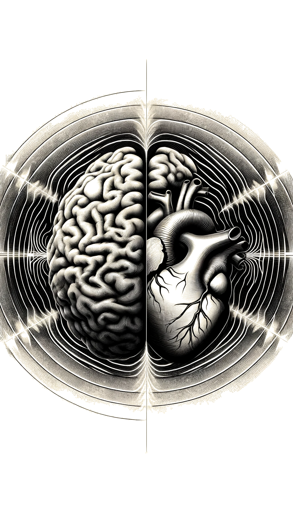
</p>

BrainBeats is an EEGLAB plugin to analyze EEG together with an ECG or PPG recorded at the same time, for brain-heart research. It works from its own menu in EEGLAB or from the command line, and provides:

1. **Heartbeat-locked EEG**: heartbeat-evoked potentials (HEP), with their time-frequency power (HRSP) and phase consistency (HRPC), on channels or independent components, tested against surrogate heartbeats, with the heart's own electrical artifact measured.
2. **Heart rate variability (HRV) and EEG features** in the time, frequency and nonlinear domains.

<p align="center" width="100%">
  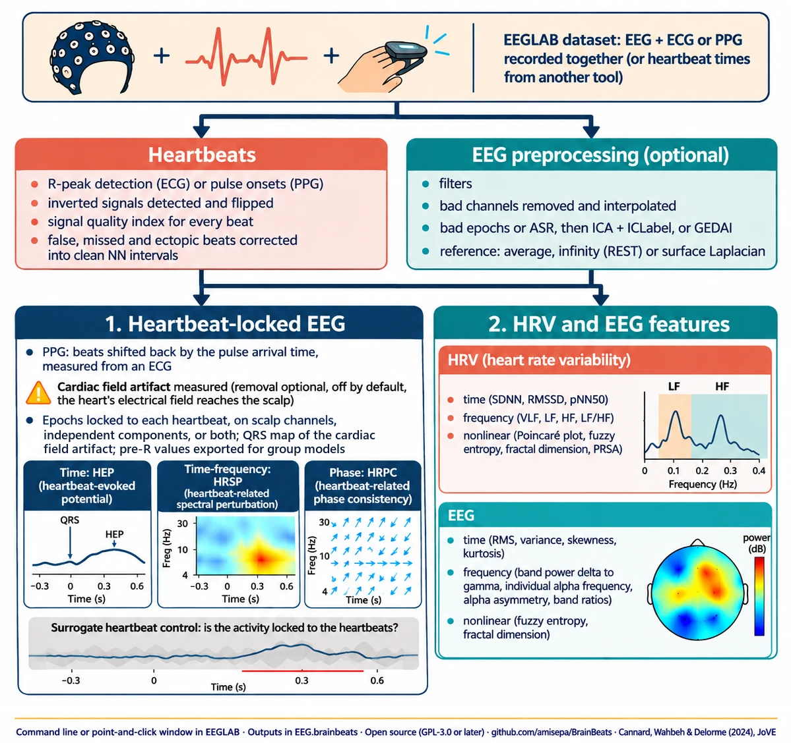
</p>

<sub>ASR: artifact subspace reconstruction. GEDAI: generalized eigenvalue de-artifacting instrument. ICA: independent component analysis. NN: normal-to-normal (cleaned) inter-beat intervals. PRSA: phase-rectified signal averaging.</sub>


## Installation

- MATLAB with the Signal Processing and the Statistics and Machine Learning toolboxes (Parallel Computing optional).
- [EEGLAB](https://github.com/sccn/eeglab) with its default plugins (clean_rawdata, ICLabel, firfilt). PICARD, REST and GEDAI are installed when an option needs them; [ASCENT](https://github.com/amisepa/Ascent) 2.1 or later computes fuzzy entropy and fractal dimension.
- BrainBeats: in EEGLAB, File > Manage extensions, search for BrainBeats, install. Or clone this repository into `eeglab/plugins`.
- Your data: one continuous EEGLAB dataset with the EEG and the heart channel(s), sampled at 1024 Hz at most (512 Hz is enough).


## Quick tutorial

The sample data in `sample_data` are 63-channel EEG with ECG and PPG at rest, eyes open, from [ds003838](https://nemar.org/dataexplorer/detail?dataset_id=ds003838): `sub-047_rest.set` (5 min, a clear heartbeat-evoked response) and `dataset.set` (4 min, with added artifacts). The figures below come from these commands (made by `tests/make_readme_figures.m`).

### 1. Open BrainBeats

Click **BrainBeats** in the EEGLAB menu bar. Choose the dataset (or the sample dataset), the analysis and the heart channel, then **Next** for the parameters.

<p align="center" width="100%">
  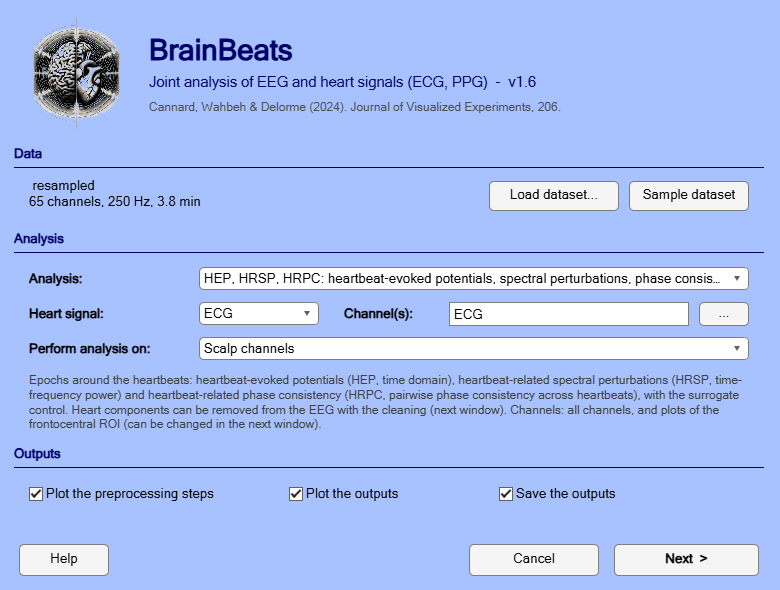
</p>

Or from the command line:

```matlab
eeglab; close
sample = fullfile(fileparts(which('brainbeats_process')), 'sample_data');
EEG = pop_loadset('filename','sub-047_rest.set', 'filepath',sample);
```

### 2. Heartbeat-evoked potentials from the ECG

```matlab
HEP = brainbeats_process(pop_select(EEG,'nochannel',{'PPG'}), 'analysis','hep', ...
    'heart_signal','ecg', 'heart_channels',{'ECG'}, 'clean_eeg',true, ...
    'hep_level','both', 'hep_surrogates',100, 'save',false);
```

BrainBeats first finds the heartbeats: R-peaks of the ECG, with false, missed and ectopic beats corrected.

<p align="center" width="100%">
  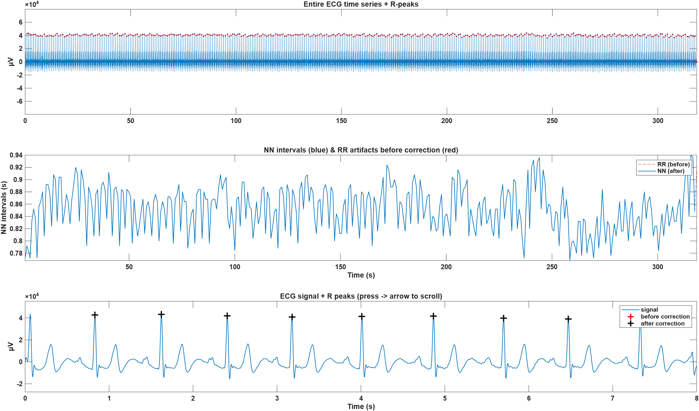
</p>
<p align="center"><em>The ECG with its R-peaks, and the inter-beat intervals before (RR) and after correction (NN).</em></p>

It cleans the EEG (filters, bad channels, bad epochs, ICA), cuts it from -300 to 600 ms around each heartbeat, and averages: the HEP.

<p align="center" width="100%">
  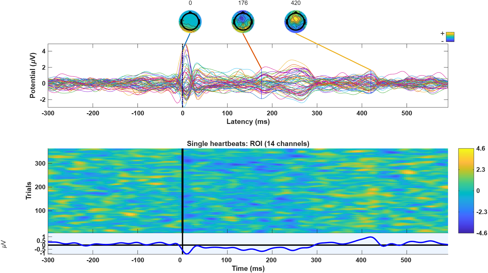
</p>
<p align="center"><em>HEP at every electrode, with scalp maps at the R-peak and at the largest later deflections (r<sub>CFA</sub>: how much each map resembles the heart artifact), and the single heartbeats of the frontocentral region.</em></p>

The surrogate control asks whether the activity is locked to the heartbeats: the same analysis at random times of the cardiac cycle.

<p align="center" width="100%">
  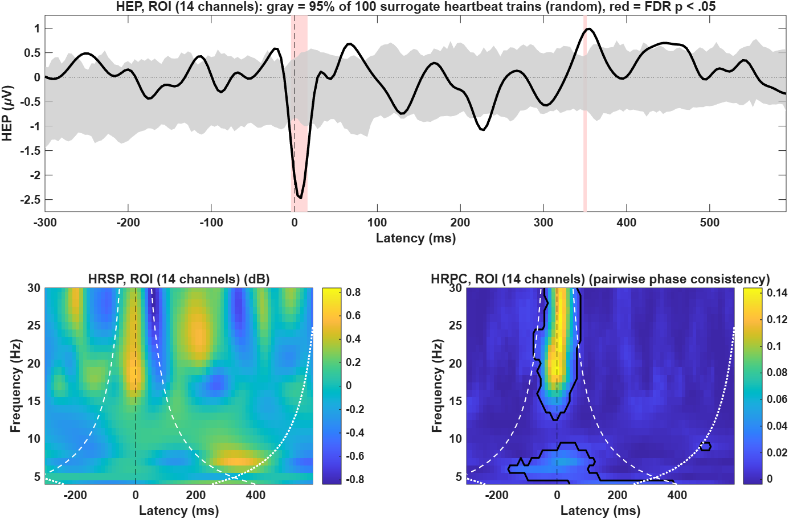
</p>
<p align="center"><em>Frontocentral HEP against 1000 surrogate heartbeat trains (gray: 95% of them; red: different, family-wise p < .05), its time-frequency power (HRSP) and phase consistency (HRPC). Here the HEP differs at the QRS, around 180 ms and at 400-430 ms. Between the dashed lines, the time-frequency values include the QRS.</em></p>

The heart's electrical field reaches the scalp at every heartbeat, like the HEP. BrainBeats maps it and checks that it stayed the same during the recording.

<p align="center" width="100%">
  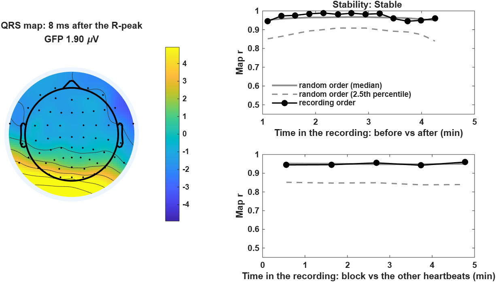
</p>
<p align="center"><em>QRS map: the scalp map of the heart artifact, and its stability over the recording (here stable).</em></p>

With `'hep_level','both'`, the same is done for each independent component.

<p align="center" width="100%">
  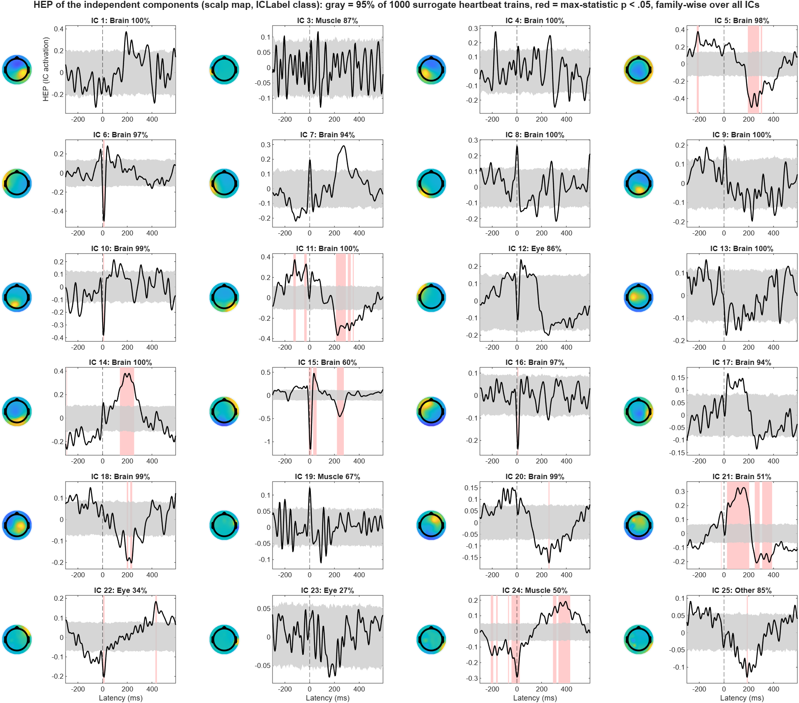
</p>
<p align="center"><em>Map, ICLabel class and HEP of each component against the surrogates. Some components labeled brain follow the QRS: heart artifact that ICLabel did not catch.</em></p>

### 3. The same from a PPG

The pulse reaches the finger about 100 ms after the heartbeat. BrainBeats shifts the PPG pulses back by this delay, measured from the ECG of the file.

```matlab
HEP_ppg = brainbeats_process(EEG, 'analysis','hep', 'heart_signal','ppg', ...
    'heart_channels',{'PPG'}, 'clean_eeg',true, 'save',false);
```

<p align="center" width="100%">
  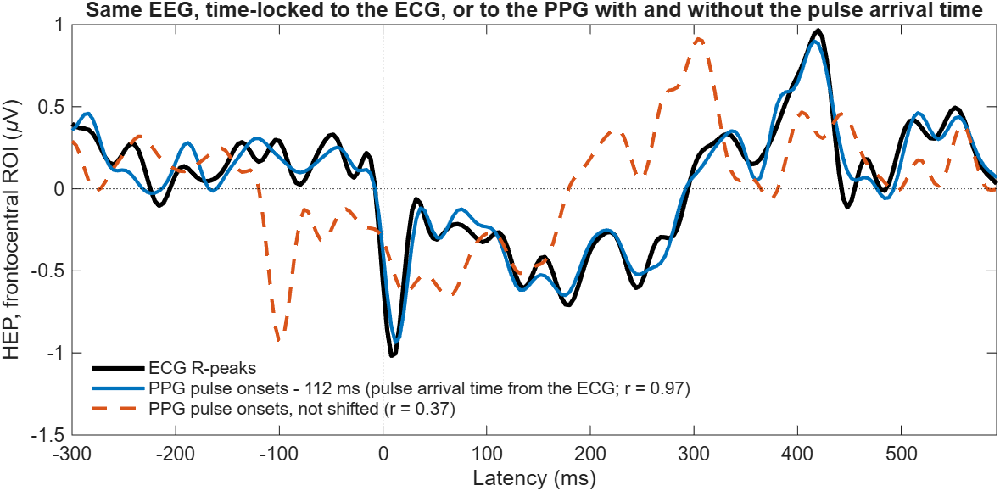
</p>
<p align="center"><em>Frontocentral HEP from the ECG (black), from the PPG shifted back (blue), and from the PPG without the shift (orange), which comes one pulse arrival time too early.</em></p>

<details>
<summary>Independent components from the PPG</summary>
<p align="center" width="100%">
  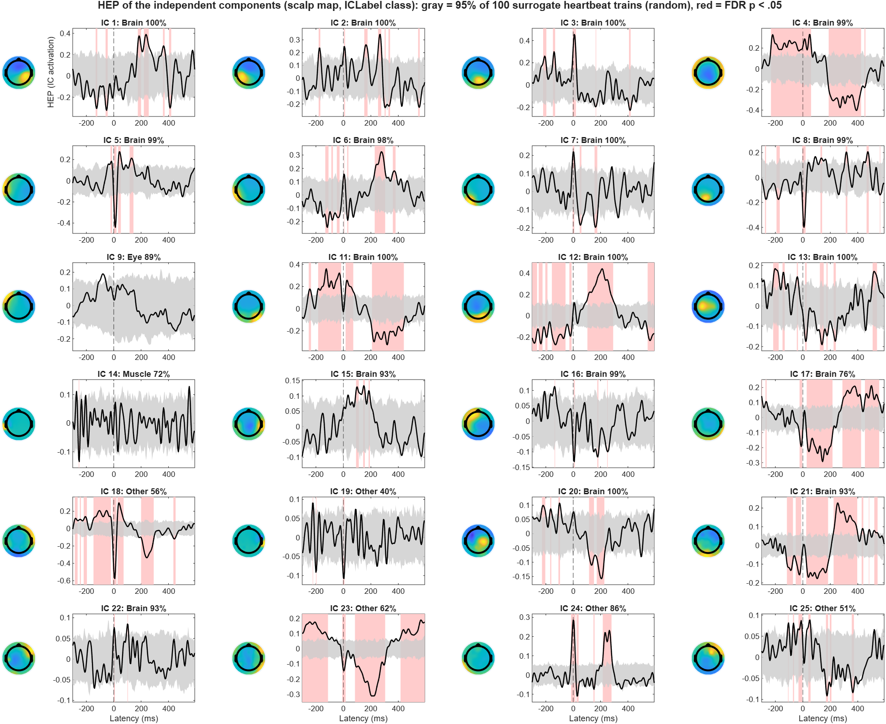
</p>
</details>

### 4. HRV and EEG features

```matlab
EEG = pop_loadset('filename','dataset.set', 'filepath',sample);
EEG = brainbeats_process(pop_select(EEG,'nochannel',{'PPG'}), 'analysis','features', ...
    'heart_signal','ecg', 'heart_channels',{'ECG'}, 'clean_eeg',true, 'linenoise',50, 'save',false);
```

- HRV: SDNN, RMSSD, pNN50; VLF, LF, HF power and LF/HF; Poincaré, fuzzy entropy, fractal dimension, PRSA.
- EEG: RMS, variance, skewness, kurtosis; band power, individual alpha frequency, alpha asymmetry, band ratios, spectral edges; fuzzy entropy, fractal dimension.

<p align="center" width="100%">
  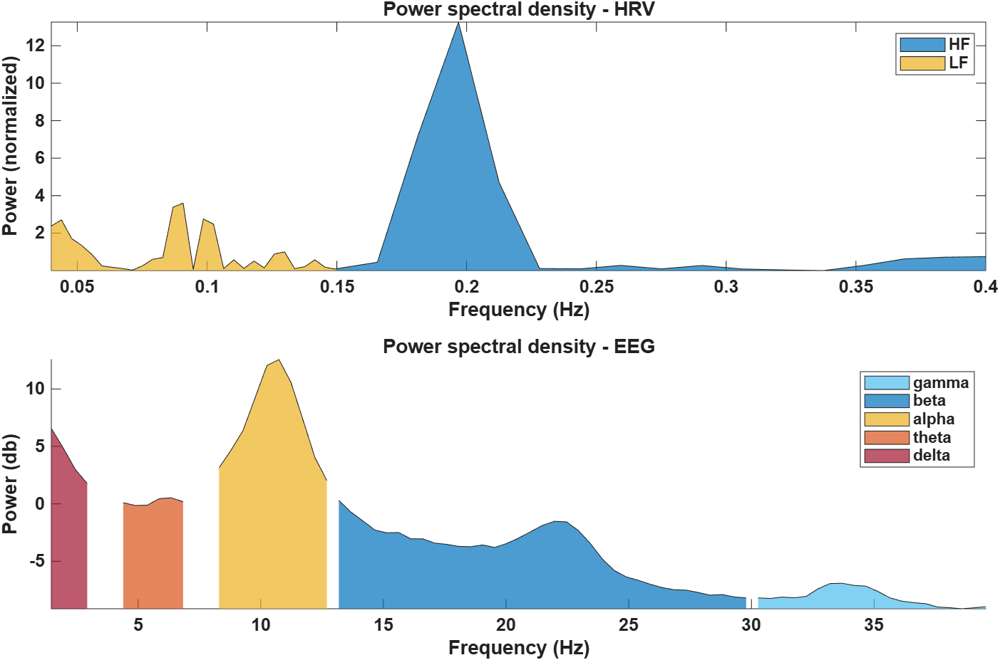
</p>
<p align="center"><em>Power spectra of the heart rate variability and of the EEG, with the frequency bands and the individual alpha frequency (IAF).</em></p>

<p align="center" width="100%">
  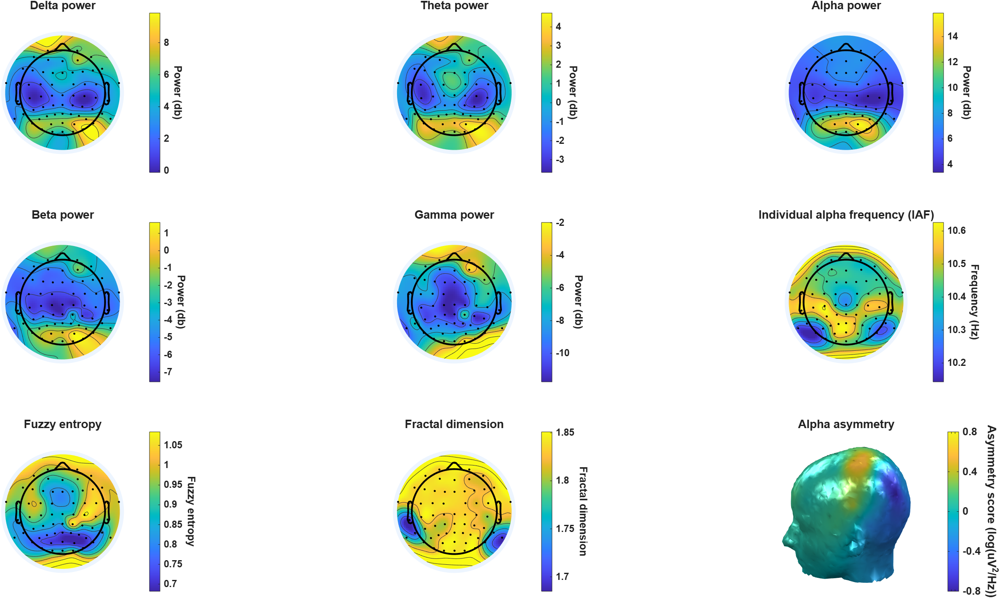
</p>
<p align="center"><em>EEG features on the scalp: band power, individual alpha frequency, fuzzy entropy, fractal dimension and alpha asymmetry.</em></p>

### Outputs

- Everything is in `EEG.brainbeats` (or `HEP.brainbeats`): parameters, heartbeats and their quality, features, HEP, HRSP, HRPC, surrogate statistics, QRS map, and values of each heartbeat before its QRS for group-level models.
- With `'save'` (on by default), the results are saved next to the input file.
- After a run from the window, `eegh` gives the equivalent command line.


## Good to know

- **The heart artifact is not removed by default.** On our test data, every removal method either found nothing to remove or also removed heartbeat-locked brain activity. Check the QRS map and the heart-locked amplitudes BrainBeats prints, and compare the ECG between conditions. The removal options and the measurements are in [docs/methods.md](docs/methods.md#heart-artifact).
- **The surrogate control tests heartbeat locking**, not a brain origin (the heart artifact is heartbeat-locked too) and not differences between conditions.
- **HEP without 'clean_eeg'** needs EEG that is already high-pass filtered: BrainBeats stops otherwise.
- **HRV**: occasional ectopic beats are corrected. Frequent ones or atrial fibrillation give a warning: HRV values are then unreliable.
- **Fuzzy entropy changed in v1.7** (now from ASCENT): do not pool it with values from older versions.
- **Brain-heart coherence** (`'analysis','coherence'`, command line only) is experimental: do not interpret it.


## Documentation

- `brainbeats_tutorial.m`: every method on the sample data, from the command line.
- `help brainbeats_process`: all options.
- [docs/methods.md](docs/methods.md): the methods in detail, with the measurements behind each choice.
- [CHANGELOG.md](CHANGELOG.md): version history, and how each version changes results.
- [tests/README.md](tests/README.md): tests and validation scripts.
- JoVE [article](https://www.jove.com/t/65829/brainbeats-as-an-open-source-eeglab-plugin-to-jointly-analyze-eeg) and [video](https://www.jove.com/v/65829/author-spotlight-advancing-study-brain-heart-interplay-with) (v1.4: the menus and some defaults have changed since).


## Citation

Cannard, C., Wahbeh, H., & Delorme, A. (2024). BrainBeats as an Open-Source EEGLAB Plugin to Jointly Analyze EEG and Cardiovascular Signals. Journal of visualized experiments: JoVE, (206).

<details>
<summary>BrainBeats was used or cited in</summary>

Abdollahpour, N., & Artan, N. S. (2025). Significant interactions in infant operculum regions when exposed to a bilingual environment: a resting-state fNIRS study. Neurophotonics, 12(4), 045012-045012.

Abdullah, J.et al. (2025). Mathematical Decoding of the Correlation Between Different Organs' Activities: A Review. Fractals, volume 33, issue: 09.

Liu, P., Gao, Y., Ballegaard, M., & Puthusserypady, S. (2025, July). A Novel Framework for Real-Time ECG and Blood Pressure Signal Analysis: Enhancing Accuracy and Interaction through Dynamic Quality Evaluation. In Annual International Conference of the IEEE Engineering in Medicine and Biology Society. IEEE Engineering in Medicine and Biology Society. Annual International Conference (Vol. 2025, pp. 1-7).

Carbone, F., Silva, M., Leemann, B., Hund-Georgiadis, M., & Hediger, K. (2025). Registered Report Stage I: Neurological and physiological effects of animal-assisted treatments for patients in a minimally conscious state: a randomized, controlled cross-over study. Neuroscience.

Balasubramanian, K. et al. (2025). Complexity Measures in Biomedical Signal Analysis: A Clinically-Grounded Survey Across EEG, ECG, Intracranial Pressure, and Photoplethysmogram Modalities. IEEE Access.

Remiszewski, M. (2025). Long-term Aerobic Exercise Enhances Interoception and Reduces Symptoms of Depression and Anxiety in Physically Inactive Young Adults: A Randomized Controlled Trial. Psychology of Sport and Exercise, 102939.

Chowdhury, et al. (2025). Neural Signals, Machine Learning, and the Future of Inner Speech Recognition. Frontiers in Human Neuroscience, 19, 1637174.

Naaz, R., & Ahmad, S. (2025). ECG Data Mining Approach for Detection of Arrhythmia Using Machine Learning. In 2025 3rd International Conference on Device Intelligence, Computing and Communication Technologies (DICCT) (pp. 52-57). IEEE.

Cheng, X., Maess, B., & Schirmer, A. (2025). A Pleasure That Lasts: Convergent neural processes underpin comfort with prolonged gentle stroking. Cortex.

Georgaras, E., & Vourvopoulos, A. (2025). Physiological assessment of brain, cardiovascular, and respiratory changes in multimodal motor imagery brain-computer interface training. Research in Biomedical Engineering and Technology, 12(1), 2471680.

Park, S., Ha, J., & Kim, L. (2025). Improving single-trial detection of error-related potentials by considering the effect of heartbeat-evoked potentials in a motor imagery-based brain-computer interface. Computers in Biology and Medicine, 195, 110563.

Perez, T. M., Drake, E., & Sullivan, S. (2024). Assessing central nervous system and peripheral nervous system functioning in resting and non-resting conditions in a healthy adult population: A feasibility study. Chiropractic Journal of Australia (Online), 51(1), 1-32.

Akuthota, S., Rajkumar, K., & Janapati, R. (2024). Intelligent EEG Artifact Removal in Motor ImageryBCI: Synergizing FCIF, FCFBCSP, and Modified DNN with SNR, PSD, and Spectral Coherence Evaluation. In 2024 International Conference on Circuit, Systems and Communication (ICCSC) IEEE.

Ingolfsson et al. (2024). Brainfusenet: Enhancing wearable seizure detection through eeg-ppg-accelerometer sensor fusion and efficient edge deployment. IEEE Transactions on Biomedical Circuits and Systems.

Fields, C., et al. (2024). Search for entanglement between spatially separated Living systems: Experiment design, results, and lessons learned. Biophysica, 4(2), 168-181.

Cannard, C., Delorme, A., & Wahbeh, H. (2024). Identifying HRV and EEG correlates of well-being using ultra-short, portable, and low-cost measurements. bioRxiv, 2024-02.

Arao, H., Suwazono, S., Kimura, A., Asano, H., & Suzuki, H. (2023). Measuring auditory event‐related potentials at the external ear canal: A demonstrative study using a new electrode and error‐feedback paradigm. European Journal of Neuroscience, 58(11), 4310-4327.

Goodwin, A. J., et al. (2023). The truth Hertz—synchronization of electroencephalogram signals with physiological waveforms recorded in an intensive care unit. Physiological Measurement, 44(8), 085002.

</details>


## License

GPL-3.0 or later (see LICENSE). The signal quality functions include code from the PhysioNet Cardiovascular Signal Toolbox and from J. Behar (GPL), the filters from C. Kothe (GPL), the surface Laplacian from the CSD toolbox (J. Kayser, GPL), the individual alpha frequency from restingIAF (A. W. Corcoran), the scalp maps from EEGLAB's headplot, and two small utilities (progressbar; gong, by J. Gooden). GEDAI, installed on request, has its own noncommercial license.
