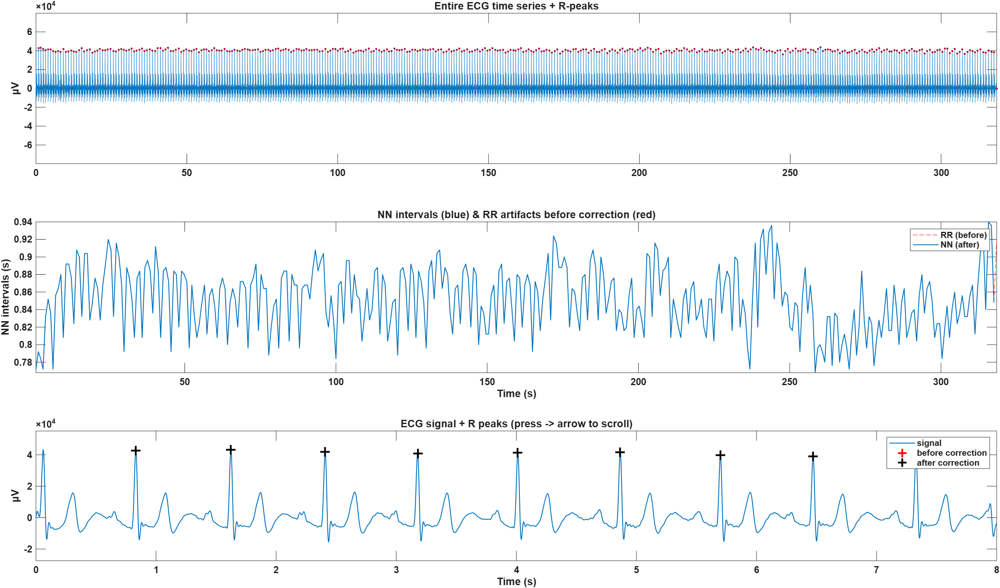
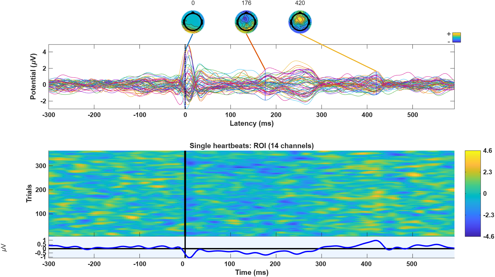
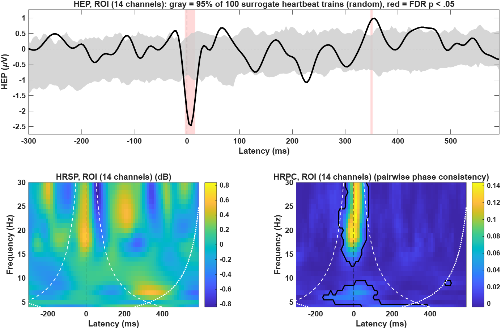
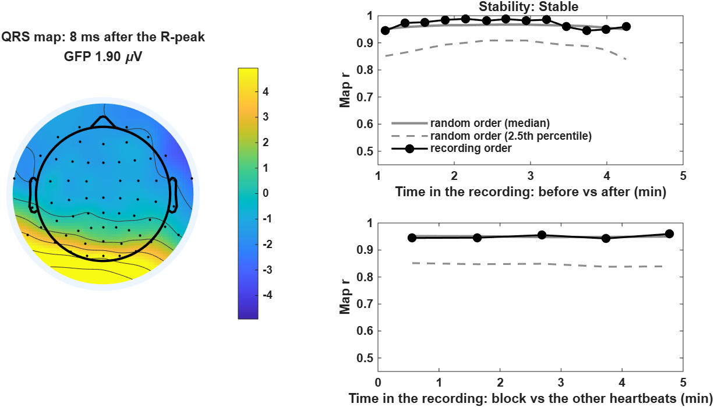
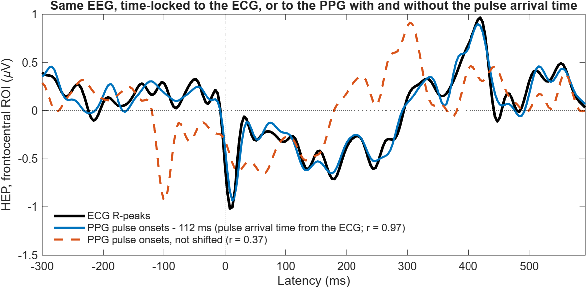
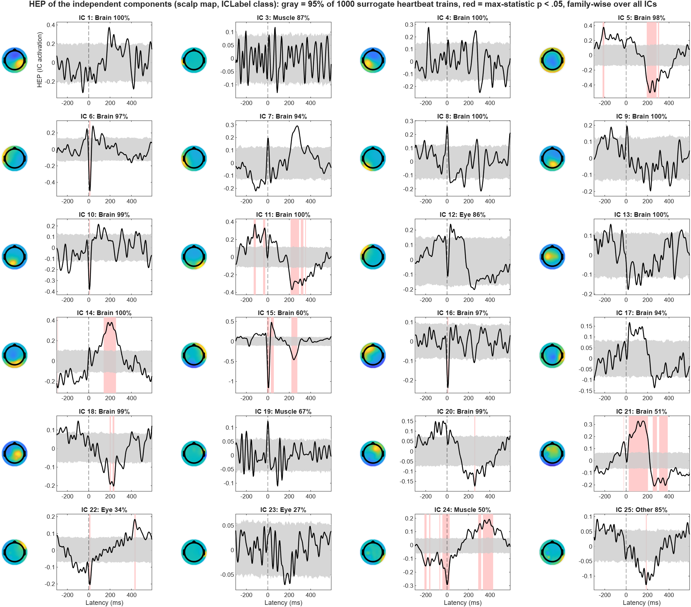
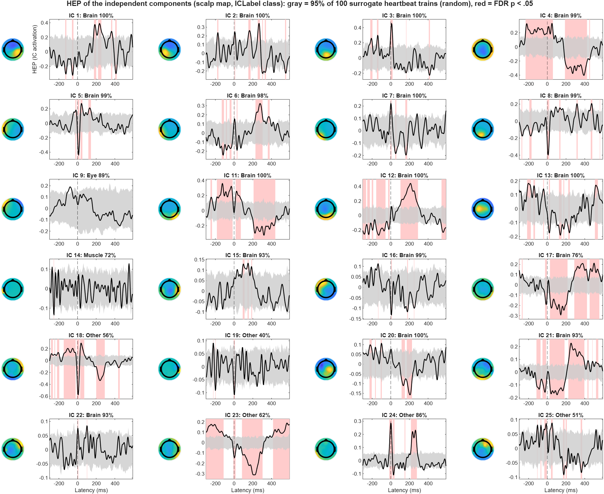
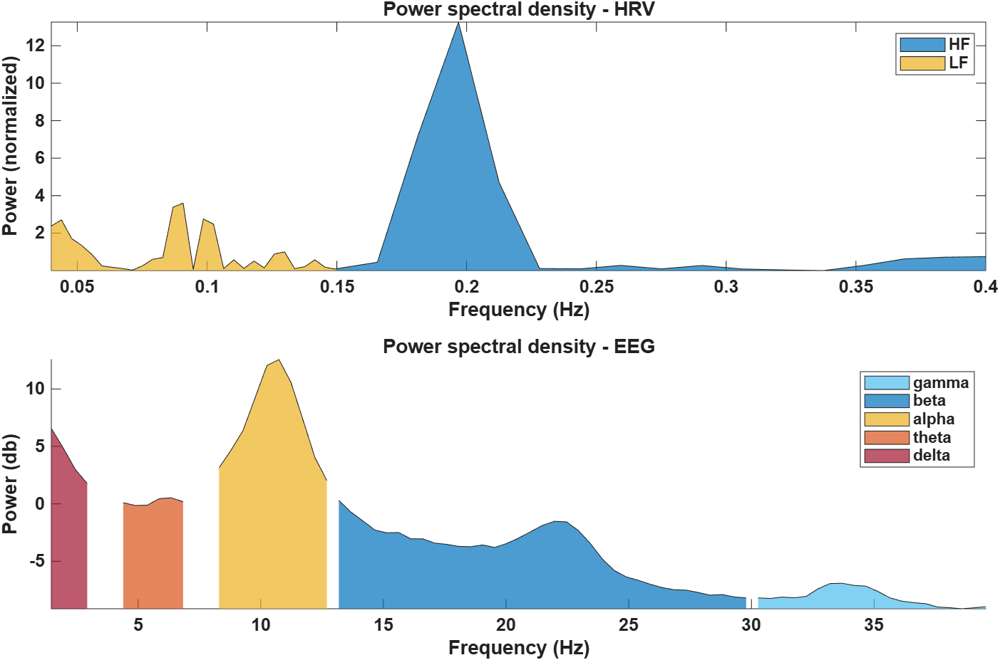
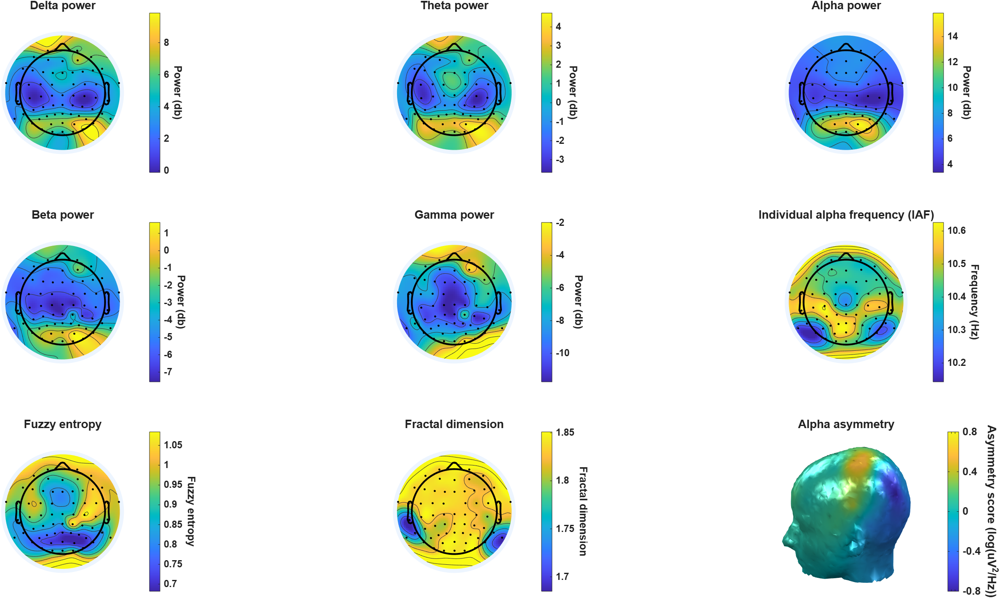

# BrainBeats methods in detail

What each step does, its defaults and options, and the measurements behind the choices (with the test or validation script that produced them, in `tests/`). The README has the overview and a quick tutorial; `help brainbeats_process` lists every option.

The figures come from the sample data (`sample_data/sub-047_rest.set` for the heartbeat-locked EEG and the heartbeat detection, `sample_data/dataset.set` for the features) and are regenerated by `tests/make_readme_figures.m`.

Contents: [Heartbeat detection](#heartbeat-detection) · [EEG preprocessing](#eeg-preprocessing) · [Heartbeat-locked EEG](#1-heartbeat-locked-eeg-hep-hrsp-hrpc) · [Heart artifact](#heart-artifact) · [EEG and HRV features](#2-eeg-and-hrv-features) · [Brain-heart coherence](#3-brain-heart-coherence-experimental)

## Heartbeat detection

All methods start from the heartbeats: R-peaks for ECG, pulse onsets ('valleys', default) or systolic peaks ('peaks') for PPG, or beat times detected with another tool ('heart_signal','rr' with 'beat_latencies' in s). For the inter-beat intervals, each detected beat is timed to a fraction of a sample (vertex of the parabola through the peak and its two neighbors), which brings the interval error of an ECG recorded at 128-250 Hz from 1.7-3.2 ms (the sample grid) to 0.04-0.24 ms and removes the bias it put on RMSSD and pNN50 (`tests/validate_subsample_rr.m`); epochs stay on the beat's sample. Inverted signals are detected and flipped: ECG leads from the polarity of the QRS complexes, PPGs from the asymmetry of their slope, measured at its 5th and 95th percentiles so that artifacts do not decide it (the systolic upstroke is the fast edge; most raw PPG outputs are light intensity, i.e. inverted, as all 70 of our test recordings of known polarity). BrainBeats computes a signal quality index (SQI), flags ECG beats detected on the wrong wave (e.g. the T-wave), and corrects RR artifacts: a false beat is removed and its interval merged with the next one, an ectopic beat (a premature beat followed by a compensatory pause, classified with thresholds scaled to the recording's beat-to-beat variability; Lipponen & Tarvainen, 2019) is replaced by a beat in the middle of its two intervals, and missing beats are inserted in gaps. This correction is meant for occasional ectopic beats: with frequent ones (e.g. bigeminy) or atrial fibrillation, the thresholds grow with the irregularity and most abnormal beats stay, so BrainBeats warns when more than 10% of the heartbeats still alternate between short and long intervals after cleaning; HRV measures are then unreliable. With several heart channels, the one with the fewest abnormal beats is used. PPG pulses are detected relative to the local pulse amplitude, so pulses are kept where the amplitude drops.

  

<em>ECG signal with the detected R-peaks, and the RR intervals before and after artifact correction (NN intervals).</em>

## EEG preprocessing

With 'clean_eeg' (on by default in the GUI):

- FIR filters: 0.5-30 Hz for HEP (the slow HEP components are kept), 1-40 Hz for features (the gamma band ends at 40 Hz); a line-noise notch when 'linenoise' is given and below the low-pass (for HEP, the copy the ICA is fitted on is always notched); zero-phase or causal.
- HEP: ICA is fitted on a continuous copy of the data high-passed at 1 Hz (slow drifts degrade ICA and ICLabel), not low-passed (line noise and its harmonics notched, at 'linenoise' or at the 50 or 60 Hz peak detected in the data; 'ica_lowpass'), cleaned with a lax ASR that keeps the eye activity ('ica_asr', default 80 SD), and ICLabel classifies the components on it; the weights are applied to the 0.5-30 Hz data. On 6 recordings (`tests/ica_compare.m`), this copy gave as many or more dipolar ICs (residual variance < 15%) than a 30-Hz copy on each recording (in total 165 vs 144 with Picard, 156 vs 133 with Infomax), let ICLabel see muscle, and took half the ICA time of the former epoched copy; the HEP and the eye activity left were unchanged. Resampling a 30-Hz copy to 100 Hz was faster but gave fewer dipolar ICs (129 vs 133).
- Bad channels removed (clean_rawdata) and interpolated.
- Artifact removal ('clean_method'): bad epochs (HEP) or ASR (continuous data), then ICA and ICLabel ('asr_ica', default). Bad HEP epochs are outliers in amplitude or in high-frequency noise over the analysis window, the latter measured on the broadband copy the ICA is fitted on (the HEP data are low-passed at 30 Hz): with 15 added muscle-like bursts per recording, this caught 15 of 15 on 5 of 6 recordings, the former metrics 0-2 (`tests/compare_badepoch_metrics.m`); or GEDAI ('gedai'; Ros et al., 2025), which removes artifacts from the continuous data without ICA (installed from the EEGLAB extension manager if needed; noncommercial license).
- Reference ('ref'): average (default), infinity (REST), surface Laplacian ('csd', current source density with spherical splines; applied after the artifact removal, since ICLabel needs average-referenced data; channels must have 10-05 labels), or none ('off').

## 1. Heartbeat-locked EEG: HEP, HRSP, HRPC

- EEG epochs from -300 to 600 ms around each heartbeat ('hep_window'), time-locked to the heartbeats kept after RR correction. Heartbeats followed by the next one before the end of the epoch + 50 ms are rejected, so no epoch contains the next QRS, as are outlier inter-beat intervals. 'hep_window','adaptive' sets the epoch end from the subject's heart rate (within-subject analyses only).
- No baseline correction: the pre-R-peak window holds activity of the previous cardiac cycle, and the recent methods review of Steinfath et al. (2026) recommends reporting HEPs without baseline correction and testing the baseline window. For a regression-based correction (Alday, 2019), each heartbeat's baseline voltage is exported (below) for the group-level model ('hep_baseline' was removed in v1.7). BASELINE_REGRESSION applies it to epochs that pool conditions. Without 'clean_eeg', the EEG must already be high-pass filtered: BrainBeats stops on unfiltered data, whose channel offsets (hundreds of times their variability within 1 s in raw recordings) would otherwise be the HEP and its scalp maps.
- Values of each heartbeat before its QRS, for group-level covariates or single-trial models (EEG.brainbeats.prestim; with 'save', the ROI values in `<file>_HEP_beats.csv`): the baseline voltage ('hep_baseline_win'; the regressor of Alday's correction) and the induced theta, alpha and beta power from the epoch start to -50 ms, with each heartbeat's time and inter-beat interval. They are not used to correct the HEP: within one recording, a regressor centered on its mean cannot change the average HEP. They matter when conditions or groups differ in ongoing power.
- HRSP and HRPC (pairwise phase consistency across heartbeats) from 4 to 30 Hz, with 5-cycle Morlet wavelets applied to the continuous data. HRSP is expressed relative to the whole cardiac cycle. HRPC is the pairwise phase consistency across heartbeats (Vinck et al., 2010), unbiased by the number of heartbeats. The HRSP plotted is that of the induced power: the HEP, cardiac field artifact included, is subtracted from each heartbeat before the power is taken (Cohen & Donner, 2013), over the whole wavelet support (no edge effect); 'hep_tf_power','total' plots all the power, and both are stored. The QRS complex's broadband field is in every epoch: with all the power, latencies away from it show a power decrease relative to the cycle that the surrogate control finds significant (synthetic QRS 5 times the noise SD, amplitude varying 15% across heartbeats: -1.9 dB, every point away from the QRS FDR-significant); with the induced power, -0.08 dB and none (`tests/test_compute_hep_tf.m`). The subtraction removes the heartbeat-locked part only as far as it repeats identically from beat to beat.
- Where ('hep_level'): on all channels ('channels', default; plots of the average of a channel ROI, 'hep_roi', default frontocentral: F1-F4, Fz, FC1-FC4, FCz, C1-C4, Cz), on the independent components ('ics'), or both ('both'). The three measures and the surrogate control are computed the same way in both cases.
- Independent components: the HEP, HRSP, HRPC and surrogate control of every IC left after the cleaning (of the cleaning ICA, or of an ICA run for this), exported with their scalp maps and ICLabel classes; the IC numbers are those of the decomposition, and the ICs removed by the cleaning are listed. BrainBeats does not select ICs: whether a heartbeat-locked brain response can be separated from the cardiac field artifact is not established, and on the sample data the most heartbeat-locked ICs also followed the ECG's QRS or T-wave.
- Surrogate heartbeat control ('hep_surrogates', e.g. 100): one surrogate beat is drawn at a random position in each inter-beat interval, so the surrogate beats fall at random cardiac phases, and their windows avoid the epochs rejected by the cleaning and the data before the first and after the last epoch, which no cleaning step checks (on the tutorial dataset, whose first seconds hold large artifacts, the surrogate band was 4.6 times narrower with these exclusions). The HEP, HRSP and HRPC at each latency are compared with the surrogates. For the HEP (at least 1000 surrogates), the points shown as different ('hep_surr_stat') are family-wise corrected over all latencies (and channels or ICs) with the max statistic ('tmax', default), or with threshold-free cluster enhancement along time ('tfce'; Smith & Nichols, 2009), which favors sustained effects over isolated peaks, or per point with FDR ('fdr'); the max statistic and FDR are always stored, TFCE only when chosen. On simulated noise (`tests/sim_hep_fwer.m`), all three kept the chance of any false positive at or below ~5%; with a response at 400 ms, FDR flagged other latencies in 14% of the runs (max statistic 4%, TFCE 7%), and TFCE detected the response most often (51% vs 43-45% with one channel, 20% vs 13% with 16 channels), but it took 28% of the computing time (16 channels, 27 frequencies, 100 surrogates), hence the max statistic by default. The surrogates sample all cardiac phases, so each latency is compared with the average over the cardiac cycle: a large heartbeat-locked deflection (the QRS, a strong HEP) moves the rest of the cycle the other way, and latencies without a response of their own then differ too (response of 0.5 noise SD: TFCE flagged other latencies in 35-60% of the runs; 1 SD: in all). Away from a large deflection, a significant point means "differs from the cycle average", not "heartbeat-locked activity at this latency". A pre-R-peak reference would avoid this only if its window held no heartbeat-locked activity: in simulations with an ECG-shaped cardiac field it did (other latencies flagged in 2-9% of the runs vs 15-47% against the cycle average; `tests/sim_surrogate_reference.m`), but on real recordings the P wave falls 100-170 ms before the R-peak and, at faster heart rates, the previous heartbeat's late activity reaches -300 ms, and the latencies found changed with the window (`tests/check_surrogate_reference.m`). HRSP and HRPC get the same statistics (family-wise over channels, frequencies and latencies; the contours of the plots use 'hep_surr_stat'). This is a check of heartbeat locking: the cardiac field artifact is heartbeat-locked too, so it does not show a neural origin, and it does not compare conditions. (Shifting the whole train instead, as Park et al., 2018, keeps the surrogates heartbeat-locked: that tests contrasts between conditions; 'hep_surrogate_mode' was removed in v1.7.)
- PPG: the pulse reaches the sensor after the heartbeat (pulse arrival time), so the PPG beats are shifted back by it ('ppg_transit','auto'), measured from an ECG channel of the file. Without an ECG, give the delay in ms (e.g. measured with an ECG on the same device and sensor site), or 'eeg' to estimate it from the cardiac field artifact of the EEG, which precedes each pulse by that delay: check its figure. On 6 subjects of ds003838 (pulse onsets at the finger, 92-112 ms after the R-peak), the ECG-based correction recovered the ECG-locked HEP (r = .68-.92; .16-.39 without it), the EEG estimate was right on 3, wrong on 1 (by 300 ms) and not clear enough on 2, and a fixed 250 ms did not fit any: there is no silent estimate without an ECG.

The cardiac field artifact is not removed by default, and can remain after any removal method, around the QRS and over the T wave (~200-400 ms), the usual HEP window: check the heart-locked EEG amplitudes BrainBeats reports (see Heart artifact below) before interpreting HEP effects.

QRS map ('hep_cfa', on by default; EEG.brainbeats.cfa, and with 'save' `<file>_HEP_CFA.png` and `_HEP_CFA.txt`): the scalp map of the cardiac field artifact at the QRS, with notes on how to use it. Its shape follows the orientation of the heart's electrical axis relative to the electrodes, so it changes with posture (lying, sitting, standing), with the orientation of the head relative to the torso (turning or nodding; Dirlich et al., 1997), with the electrode positions and the reference, and between people. Compare conditions on it: different maps mean different cardiac field artifact left in the data, which alone can produce HEP differences. Record all conditions in the same posture with the head supported the same way; posture also changes the HEP itself (larger lying down than upright; Plantard et al., 2025). BrainBeats also tests whether the map changed during the recording (map of the heartbeats before vs after each time point, and of each block vs the rest, against the same with the heartbeats in random order) and warns if it did. The test only sees large lasting changes: simulating a head turn for half of the recording by rotating the electrodes in a fixed cardiac field (`tests/sim_cfa_drift.m`, 12 resting recordings of 120-370 heartbeats, raw and cleaned), it never fired on the unchanged recordings and detected a 30° turn in 3-4 of 12, a 20° turn in 1-2, a 10° turn in 0-1. A shifted time-locking changes the map too (a PPG pulse arrival time drifting by ~20 ms or more, R-peaks detected on another wave). A stable result does not exclude movements.

  

<em>HEP from the ECG (cleaned EEG): all electrodes with scalp maps at the R-peak (cardiac field artifact) and at the largest deflections of the ROI HEP at 150-350 ms and after 350 ms (top), each with its spatial correlation with the cardiac field artifact at the QRS (rCFA; the map at the largest global field power from -30 to 60 ms; here the 420-ms map resembles the inverted QRS map, r = -0.62, which this map alone cannot attribute to the heart or the brain), and single heartbeats of the frontocentral ROI (bottom).</em>

  

<em>Frontocentral ROI: HEP against 1000 surrogate heartbeat trains (gray: 95% of the surrogates; red: max-statistic p < .05, family-wise), HRSP of the induced power (HEP subtracted from each heartbeat; dB relative to the cardiac cycle) and HRPC, with the contours of max-statistic p < .05 (family-wise). Dashed white lines: ±2 SD of the wavelets around the R-peak, where the time-frequency values include the QRS. Dotted white lines: the same for the nearest previous and next heartbeats. Here the HEP differs from the surrogates (the cardiac-cycle average) at the QRS, at 172-184 ms (and one point at 244 ms), and at 396-428 ms (+1 µV, after the end of the T wave at ~300 ms; largest at Fz, F1, FC2 and Cz, not at the frontal pole).</em>

  

<em>QRS map ('hep_cfa'): the scalp map of the cardiac field artifact at its largest global field power (8 ms after the R-peak), and its stability over the recording: correlation of the map of the heartbeats before vs after each time point (top) and of each fifth of the recording vs the other heartbeats (bottom), against the same with the heartbeats in random order (gray: median and 2.5th percentile). Here stable.</em>

  

<em>Frontocentral HEP of the same EEG time-locked to the ECG R-peaks (black), to the PPG pulse onsets shifted back by the pulse arrival time measured from the ECG (blue), and to the PPG pulse onsets themselves (orange): without the shift, the cardiac field artifact and the HEP come one pulse arrival time too early.</em>

  

<em>Independent components ('hep_level','ics'), ECG: scalp map, ICLabel class and HEP of each IC left after the cleaning (the first 24; IC 2 was removed by the cleaning), against 1000 surrogate heartbeat trains (gray: 95% of the surrogates; red: max-statistic p < .05, family-wise over all ICs and latencies). Some ICs follow the QRS complex and the T wave (e.g. IC 15) or the QRS only (ICs 6, 10 and 16, classified brain): cardiac field artifact that ICLabel did not classify as heart.</em>

  

<em>The same from the PPG (beats shifted back by the pulse arrival time). The ICA is fitted on the same continuous copy of the data, so the ICs are those of the ECG run.</em>

## Heart artifact

The electrical field of the heart reaches the scalp (cardiac field artifact) and is time-locked to the heartbeat, like the HEP. In the HEP analysis, 'heart_removal' sets whether the EEG cleaning removes it. **The default is 'none', and we recommend keeping it**: on our test data, every method either found nothing to remove or also removed heartbeat-locked brain activity (table below). The methods are there to compare and to check results, not as a correction:

- 'ica': the independent components (ICs) that ICLabel classifies as heart ('conf_thresh', default 0.75) are removed with the other artifact ICs.
- 'ica_caracas': the ICs that CARACAS classifies as cardiac (Champetier et al., 2025: R waves detected in each IC's time course; no ECG needed). Needs the SASICA plugin (`git clone --recurse-submodules https://github.com/dnacombo/SASICA` into `eeglab/plugins`). It runs on the continuous data, without the stretches of large artifacts.
- 'ica_ecg' (ECG): the ICs whose time course correlates with the ECG (|r| ≥ 'ecg_corr', default 0.6, as in SASICA). The correlations are stored in EEG.brainbeats.preprocessings.heart_ics.
- 'ecg_regression' (ECG, no ICA): the ECG, filtered like the EEG and shifted by -20 to +20 ms, is regressed out of each EEG channel. The fit uses the samples without large EEG artifacts.
- 'ssp' (ECG): the first 'ssp_n' (default 2) scalp topographies of the heartbeat-locked average EEG are projected out of the data (signal-space projection, as MNE's compute_proj_ecg). The projection removes these topographies at all times, brain activity included.

The heart-locked EEG amplitude is printed and stored in EEG.brainbeats.preprocessings before and after the cleaning, around the QRS (-50 to 100 ms: cfa_before, cfa_after) and from 200 to 500 ms (cfa_late_before, cfa_late_after; this window also holds any neural HEP). Check them before interpreting HEP effects.

On 6 subjects of ds003838 (resting state, 63 channels, ~3 min each; `tests/compare_heart_removal.m`, which also adds a synthetic 1-µV response 300 ms after each R-peak on the frontocentral channels and measures how much of it is left):

| | Heart-locked amplitude removed (-50 to 100 ms) | Synthetic response kept (vs no removal) |
|---|---|---|
| 'ica' | 0% on all 6 (ICLabel found no heart IC) | 100% |
| 'ica_caracas' | 0% on all 6 (no IC classified as cardiac; on the sample data, the IC most correlated with the ECG failed only the skewness criterion) | 100% |
| 'ica_ecg' | 0% on all 6 (no IC reached \|r\| = 0.6; 0.55 at most on the sample data) | 100% |
| 'ecg_regression' | 29% on average (3-70%; ~70% where the artifact was largest, ~2 µV) | 80% on average (54-100%) |
| 'ssp' | 52% on average (27-73%) | 57% on average (39-76%) |
| ICA with the ECG channel (former 'rm_heart', removed in v1.6) | 19% (0-47%) | 7% on average (5 of 6 near 0%) |

The methods that remove part of the artifact also remove heartbeat-locked brain activity, and the methods that select ICs found none to remove in these recordings (short, low artifact amplitude). The synthetic response is idealized (perfectly heartbeat-locked, fixed topography), so real losses may be smaller, but nothing tells the methods apart from a real HEP. In patients with an isoelectric EEG (no brain activity, so any heartbeat-locked signal is artifact), the artifact varied widely between patients and was not predicted by their ECG, possibly because it includes pulse-related movement; compared with controls, removing heart ICs weakened the HEP effect, and the surface Laplacian removed an effect that depended on the reference (Kandasamy et al., 2026, preprint).

The cardiac field artifact is not a constant either. Breathing rotates the electrical axis of the heart and changes the impedance of the thorax, so the ECG, and the artifact, change over the respiratory cycle (the basis of ECG-derived respiration; Moody et al., 1985). Heart rate moves the T wave (the QT interval shortens as heart rate rises), and stroke volume and body position change the artifact too: the heartbeat-evoked MEG response co-varied with stroke volume from beat to beat only when the cardiac artifact was not corrected (Buot et al., 2021). So conditions that differ in breathing, heart rate, stroke volume or posture can produce HEP differences without any difference in brain activity, whether the artifact is removed or not. Instead of relying on a removal method:

- compare the ECG between conditions: its heartbeat-locked average, heart rate and, if recorded, breathing;
- check the heart-locked amplitudes reported above, and whether an effect overlaps the QRS or the T wave of the ECG;
- use the surrogate heartbeat control ('hep_surrogates') for heartbeat locking, and the surface Laplacian ('ref','csd'), which attenuates the broad cardiac field relative to local activity;
- for condition contrasts, use a surrogate-heartbeat correction (Steinfath et al., 2026) or, in task data, a pseudotrial correction (Steinfath, Herzog, Fourcade, Sander, Nikulin & Villringer, 2025, Imaging Neuroscience, 3, IMAG.a.30).

## 2. EEG and HRV features

From the continuous data:

- HRV time domain: SDNN, RMSSD, pNN50
- HRV frequency domain: ULF, VLF, LF and HF power (ms²), LF/HF ratio, relative power ('hrv_norm'); Lomb-Scargle periodogram by default, 'welch' or 'fft' on the NN series resampled at 7 Hz, or 'LombScargle_norm' (unitless, divided by the variance of each window: its values grow with the heart rate)
- HRV nonlinear domain: Poincaré (SD1, SD2, SD1/SD2), fuzzy entropy and fractal dimension (ASCENT plugin: original FuzzyEn, m = 2, r = 0.15, n = 2; box-counting dimension with a robust fit), PRSA acceleration and deceleration capacities (Bauer et al., 2006; anchors whose interval changes by more than 20% are left out, 'prsa_thresh'. Bauer et al. used 5% on 24-h recordings, which left out 18-61% of the anchors and halved the capacities on our 3-min resting recordings, so the values are not comparable with their risk cut-offs)
- EEG time domain: RMS, variance, skewness, kurtosis, IQR
- EEG frequency domain: band power (delta 1-4, theta 4-8, alpha 8-13, beta 13-30, gamma 30-40 Hz, each from its lower edge up to its upper edge; optionally individualized from the alpha peak), individual alpha frequency (IAF, alpha center of gravity) and peak alpha frequency, alpha asymmetry (ln right - ln left alpha power, e.g. F4 - F3: positive values mean relatively more left-hemisphere activity; each left electrode paired with its mirror position), absolute and relative power, band ratios, median and 90% spectral edge frequencies
- EEG nonlinear domain: fuzzy entropy, fractal dimension (ASCENT plugin, as for HRV, on the data resampled to ~90 Hz when recorded faster)

  

<em>Power spectral density of the HRV (ms²/Hz) and of the EEG (dB, 20% trimmed mean across channels), with the frequency bands used and the individual alpha frequency (IAF).</em>

  

<em>EEG features on the scalp: band power, IAF, fuzzy entropy, fractal dimension and alpha asymmetry.</em>

## 3. Brain-heart coherence (experimental)

Coherence, partial coherence, directed coherence and partial directed coherence between each EEG channel and the NN series, from a multivariate autoregressive model ('analysis','coherence', command line only). **Do not interpret these values.** The NN series is interpolated at the EEG sampling rate and high-passed at 0.5 Hz, so it holds almost no heart rate variability in the 0-40 Hz bands analyzed, and the model is not fitted at the time scales of heart rate variability. The analysis is kept for development and is not offered in the BrainBeats window.
